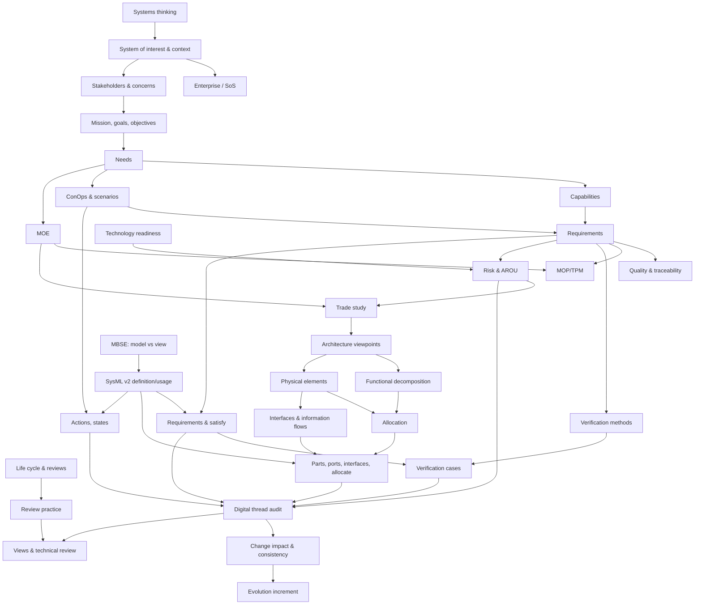

# Proposed Course Syllabus: Pathway B (Integrated 14-Week Course)

## Systems Thinking and Model-Based Systems Engineering with SysML v2: The Air Taxi Enterprise

| | |
|---|---|
| **Status** | **PROPOSAL, not institutionally approved.** **Revision 1**, 2026-10-09, revised after independent review round 1 (`_source_cache/review/external_review_round1.md`; disposition in `ACADEMIC_QUALITY_REVIEW.md`). |
| **Relationship to official drafts** | This is a **new, distinct course**. It is **not** a compressed copy of the two draft syllabi (S01 Foundations of Systems Thinking and Technology Literacy; S02 Model-Based Systems Integration with SysML v2), and it replaces neither. Content taken from S01–S04 is marked **[S0x]**; everything else is **[REC]**. |
| **Course number / credits** | TBD. **[REC]** 3 credit hours (FD-02 discusses a 4-credit alternative). |
| **Delivery** | **[S01/S02]** Hybrid active learning (pre-class, in-class, post-class). |
| **Companions** | Weekly detail: `WEEKLY_INSTRUCTIONAL_PLAN.md` Part B · Labs and capstone: `LABORATORY_AND_CAPSTONE_PLAN.md` Part B · Rubrics: `ASSESSMENT_RUBRICS.md` · Outcome evidence (single source of truth): `COURSE_OUTCOME_ASSESSMENT_MATRIX.md` · Decisions: `FACULTY_DECISION_REGISTER.md` |

**Changes in revision 1** (review finding IDs in brackets):
- B-CLO4 now covers the architecture as well as the model (C2, M7).
- The evidence columns are regenerated from the checked matrix (C2).
- Attainment is conjunctive (C3).
- The SysML gate is tool-neutral (C1).
- `satisfy` semantics are corrected (M2).
- The review calendar fits the available sessions (M3).
- There is a SysML on-ramp from Week 5 (M6).
- Reading pages are article body pages (M1).
- Workload figures are corrected (M5).
- Minor findings fixed: m1, m9, m11, m12, m14, m18, m20, m22.

---

## 1. Course description and academic purpose

This course develops the core reasoning of a systems engineer and the core modelling skills of model-based systems
engineering (MBSE) in one semester. Students start from an ambiguous enterprise problem: a fictional urban air-taxi
operator, **AeroLink Urban Mobility** [S04 Lab 2A]. Working in teams, they move through a disciplined sequence:
1. Define the system and its stakeholders.
2. Analyse missions, needs and operational scenarios.
3. Write and verify requirements.
4. Assess technology maturity, uncertainty and risk.
5. Justify decisions with structured trade studies.
6. Describe the architecture from several viewpoints.
7. **Transform this engineering work into a SysML v2 model**, then use the model to trace requirements, plan verification and analyse the impact of change.

**Academic purpose.** The course aims at engineering judgement more than tool skill. Students must be able to explain
*why* the model is structured as it is, *what evidence* supports each decision, and *what would change* if an assumption
failed. The course follows S01's central question: how an enterprise transforms stakeholder needs into operational
capability [S01 "Course Philosophy"]. It also follows S02's discipline: model, connect, trace, analyse, communicate [S02 "Course Philosophy"].

**What this course deliberately does not do** (it is not equivalent to S01 + S02; see `CURRICULUM_COMPARISON.md` §5):
- It does not produce S01's 17-deliverable enterprise package.
- It does not meet S02's final-model minimums.
- It treats enterprise information management, security and resilience, technology roadmapping and executive storytelling at **awareness** depth only.

## 2. Intended student population and prerequisites

- **Population [REC]:** upper-division undergraduates (junior or senior) in engineering, engineering technology, computer science or the Integration degree. Early graduate students may take it on the extension track (§20, FD-19).
- **Prerequisites [REC]:**
  - junior standing or instructor permission;
  - college algebra and introductory probability;
  - spreadsheet use.
  - **No programming prerequisite.** SysML v2 textual notation is introduced through read-only micro-labs from Week 5 and modelled from Week 9, alongside the graphical notation.
- **Not assumed:** prior systems-engineering coursework. S01 is *not* a prerequisite (contrast S02, where it is [S02]).
- **Teams [S01/S02]:** 4 students preferred, 3 minimum.
- **Roles [REC]:** S02's four lead roles (Requirements & Compliance, Architecture, AI & Data Management, V&V) [S02 "Team Roles"]. In 3-person teams, AI & Data merges with Architecture (FD-24).

## 3. Course learning outcomes (CLOs)

The table below gives, for each CLO, the observable verb, the Bloom level and the **attainment evidence**. Bloom levels follow the revised taxonomy (Anderson & Krathwohl 2001), an **external framework**.

The evidence column is copied from the single machine-checked map in `COURSE_OUTCOME_ASSESSMENT_MATRIX.md`. **I** = individual, **T** = team.

**Attainment is conjunctive:** a student must reach level ≥ 3 on the CLO's individual parts **and** on its team parts.

| CLO | On successful completion, students can… | Bloom | Attainment evidence | Official outcomes |
|---|---|---|---|---|
| **B-CLO1** | **Analyse** a socio-technical enterprise using systems-thinking principles and life-cycle concepts, identifying the system of interest and its boundary, stakeholders, external interfaces, feedback relationships and emergent behaviour. | Analyse | I: Exam 1 Part A · T: CP1 RB-1 | S01 O1 |
| **B-CLO2** | **Develop** a traceable set of need statements, operational scenarios and well-formed requirements, each with rationale, a verification method and links to MOE/MOP. | Create | I: Exam 1 Part B · T: CP1 RB-2; CP2 RB-3.1–3.5, RB-4 | S01 O2; S02 O1 (inputs) |
| **B-CLO3** | **Evaluate** alternatives under uncertainty (technology readiness with evidence, a sensitivity-tested trade study, an AROU register) to recommend a decision. | Evaluate | I: Exam 1 Part C · T: CP2 RB-5; CP3 RB-6.1–6.5 | S01 O3; S01 O5 (partial) |
| **B-CLO4** | **Construct** a multi-viewpoint architecture (functional decomposition, physical elements, interfaces, allocations) and represent it, with its requirements and behaviour, in a SysML v2 model that is valid in the course-designated checker and semantically correct. | Create | I: Exam 2 T1, T2, T5, T6 · T: CP3 RB-7 (excl. 7.4); CP4 RB-8; CP5 RB-8 | S02 O1; S01 O4 (information flows, AI capabilities) |
| **B-CLO5** | **Analyse** model-based traceability to assess verification coverage, model consistency and the impact of a proposed change. | Analyse | I: Exam 2 T3, T4 · T: CP5 RB-9, RB-10, RB-11.3 | S02 O2, O3 |
| **B-CLO6** | **Justify** engineering decisions in technical reviews to technical and non-technical reviewers, including documented, critically evaluated AI use. | Evaluate | I: review notebook (RB-16, RB-12); CP5 individual Q&A (RB-11.5) · T: RB-12 at CP1–CP4; RB-3.6; RB-6.6; RB-7.4; RB-17 (CP4 findings given); CP5 RB-11 | S02 O4, O5; S01 O4 (AI) |

**How the official outcomes are covered:**
- S01 O4 is covered at **working** depth.
- S01 O5's resilience and long-term evolution are covered at **awareness** depth.
- **Completing B does not satisfy S01 + S02** (FD-01).

## 4. Weekly learning objectives (summary; full list with Bloom levels in `WEEKLY_INSTRUCTIONAL_PLAN.md` Part B)

| Wk | Theme | Representative objective |
|---|---|---|
| 1 | Systems and systems thinking | Construct a causal-loop model and explain an emergent behaviour (Apply/Analyse) |
| 2 | Enterprises, SoS, life cycles, stakeholders | Classify AeroLink against SoS criteria; map stakeholders with stable IDs (Analyse) |
| 3 | Mission, needs, capabilities, ConOps | Write need statements and three ConOps scenarios incl. off-nominal (Create) |
| 4 | Requirements engineering I | Write well-formed requirements with rationale and verification method (Create) |
| 5 | Requirement quality, traceability, measures | Audit a peer team's requirements; define MOE→MOP→TPM (Evaluate/Create) |
| 6 | TRL, uncertainty, risk, AROU | Assess the TRL of three technologies with evidence; rate and treat risks (Evaluate) |
| 7 | Trade studies | Run a swing-weighted trade study with sensitivity and recommend (Evaluate) |
| 8 | Architecture, interfaces, information | Decompose, allocate, build an N² matrix; trace information to decisions (Analyse) |
| 9 | MBSE and SysML v2 foundations | Explain definition vs usage; build a package and part structure (Understand/Apply) |
| 10 | SysML v2 requirements and structure | Model requirements, ports and interfaces; relate them with `satisfy` and `allocate` (Apply) |
| 11 | SysML v2 behaviour | Model a scenario as an action flow and operating states as a state definition (Apply) |
| 12 | Verification and digital thread | Define verification cases; audit trace coverage (Analyse/Evaluate) |
| 13 | Change impact and consistency | Determine a change's impact set by traversing the model (Analyse) |
| 14 | Evolution, views, final review | Defend decisions in a technical review (Evaluate) |

## 5. Bloom's taxonomy alignment

The distribution is computed by a script from the **highest level of every objective** in `WEEKLY_INSTRUCTIONAL_PLAN.md` Part B. The script output is `_source_cache/verification/bloom_count.txt`.

<!-- BLOOM_TABLE -->
| Highest level | Objectives | Share |
|---|---|---|
| Understand | 11 | 19 % |
| Apply | 17 | 30 % |
| Analyse | 12 | 21 % |
| Evaluate | 13 | 23 % |
| Create | 4 | 7 % |
| **Total** | **57** | 100 % |
<!-- /BLOOM_TABLE -->

**Design intent:**
- The systems-thinking half climbs from Understand to Evaluate.
- The SysML half **drops back to Apply** while the notation is new, then climbs to Analyse and Evaluate through traceability and impact analysis. This keeps tool learning from displacing engineering judgement.

## 6. Concept dependency map

The diagram is followed by a nested-list **text alternative** (review m20).

**Text alternative.** Each item is a prerequisite of the items nested under it.

- Systems thinking
  - System of interest and context
    - Enterprise / SoS classification
    - Stakeholders and concerns
      - Mission, goals and objectives
        - Needs
          - Capabilities → requirements
          - ConOps and scenarios → requirements, and behaviour models
          - MOE → MOP/TPM
- Life cycle and reviews
  - Review practice → views and technical review
- Requirements
  - Quality and traceability
  - MOP linkage
  - Verification methods → verification cases
  - Risk and AROU (with technology readiness)
    - Trade study (with MOE)
      - Architecture viewpoints
        - Functional decomposition and physical elements
          - Allocation
          - Interfaces and information flows → SysML structure
- MBSE: model vs view
  - SysML v2 definition/usage
    - Requirements and `satisfy`
    - Parts, ports, interfaces, `allocate`
    - Actions and states
- Digital thread audit (needs model requirements, structure, behaviour, verification cases and risk)
  - Change impact and consistency → evolution increment
  - Views and technical review

## 7. Weekly schedule (two 75-minute sessions + ≈ 30 min online per week)

The schedule below is the authoritative faculty schedule of 2026-10-18 (`COURSE_SCHEDULE.md`; DECISION_LOG A19), which replaces the earlier table in this section. Week titles are the whiteboard subjects verbatim. Each team develops its own instructor-approved enterprise; AeroLink Urban Mobility is the instructor's worked example. Every week keeps the two 75-minute sessions (concept studio, lab). Weeks 2–14 are provisional while they are rebuilt from the Week 1 template.

| Wk | Phase | Whiteboard subject | Team output (what the week adds to the package or model) | Due | Individual |
|---|---|---|---|---|---|
| 1 | I. Systems Thinking | Team Formation / Needs / Identifying Stakeholders | Team charter; enterprise proposal (instructor-approved); stakeholder register; initial stakeholder needs | — | Q1 |
| 2 | I | ConOps / Requirements | ConOps with operational scenarios; stakeholder and system requirements traced to needs | — | Q2 |
| 3 | I | Technology Assessment / Risk Management / Trade Study | Technology readiness assessment; risk register; trade study with a justified decision | — | Q3 |
| 4 | I | Architecture / Information View | Architecture description: viewpoints, functional decomposition, information view | — | Q4 |
| 5 | I | Components / Interfaces | Component breakdown; interface definitions (N² chart / interface table) | — | Q5 |
| 6 | I | Evolution Roadmap | Enterprise evolution roadmap (increments, technology insertion, transition) | — | Q6 |
| 7 | I | Final Presentation | Systems Thinking Engineering Package (Weeks 1–6 integrated) and the Phase I presentation | **Systems Thinking Engineering Package** | No quiz (default; open decision) |
| 8 | II. MBSE with SysML v2 | Import Systems Thinking Artifacts / Stakeholders | Introduction to MBSE and SysML v2; model skeleton; the package imported; stakeholders and concerns modeled (models Week 1) | — | Q7 |
| 9 | II | Needs / Requirements | Needs and requirements as SysML v2 requirement definitions and usages, with traces (models Week 2) | — | Q8 |
| 10 | II | Logical / Behavioral Modeling | Logical architecture; actions, states and use cases for the ConOps scenarios (models Weeks 2 and 4) | — | Q9 |
| 11 | II | Physical / Interfaces | Physical parts, ports, interfaces and connections; allocation from logical to physical (models Week 5) | — | Q10 |
| 12 | II | Digital Thread / Verification and Validation | Verification cases, satisfy and verify relationships; digital-thread audit (models Weeks 2 and 3) | — | Q11 |
| 13 | II | Trade Study / Analysis | Analysis cases and constraints; the Week 3 trade study redone in the model (models Week 3) | — | Q12 |
| 14 | II | Final Presentation | Coherent SysML v2 enterprise model built from the team's own Systems Thinking package; final review (models Weeks 6 and 7) | **SysML v2 enterprise model** | No quiz (default; open decision) |
| Finals | — | Make-ups; overflow reviews (FD-18) | | | |

Exam placement is an open faculty decision (the earlier table had Exam 1 in Week 7 and Exam 2 in Week 13; both are now presentation weeks). The minute plan below was written for the earlier checkpoints CP1–CP5 and is kept as source material until the presentation weeks are rebuilt.

**Minute plan for review weeks (review M3):**
- **CP2:** SRR-style review is live, 8 × 7 min.
- **CP3:** defences are 8 × 5 min at the start of Week 9.
- **CP4:** the PDR-style review is **asynchronous and written**. One peer team and the instructor each return review item discrepancies (RIDs) within 3 days. The peer team's RIDs are graded with RB-17, and the owning team must disposition every RID in CP5. This matches the written peer-review process of S02 and needs no class session.
- **CP5:** each of 8 teams gets 16 min (10 min presentation including live navigation of one thread, then 6 min Q&A with ≥ 1 question per student) plus 2 min changeover. That totals 144 min of the 150 available. Overflow uses the finals slot, and rehearsal happens outside class.

## 8. Reading assignments (verified references)

**Verification (revision 1, review M1).** Every entry in `_source_cache/verification/readings.py` is checked by `verify_readings.py`. The check requires two things:
- the expected title or clause appears on the cited first page;
- for SEBoK entries, no reference list begins inside the range.

**Result: 89 of 90 entries pass.** The exception is deliberate: R30 *Digital Engineering* (p.1394–1395). Its last paragraph (Digital Twin) shares p.1395 with the start of its reference list.

**What the ranges contain:**
- SEBoK ranges are **article body pages**. Reference lists are excluded, and an article may begin before its running header.
- Every assigned body page lies within pages that the source audit read in full, checked against each reader's ledger.
- MITRE and DoD ranges include each article's short reference section, which those readers also read in full.

**Reading-rate assumption:** about 15 pp/hour for SEBoK-density text and about 30 slides/hour. This is unvalidated and is part of the workload pilot (FD-22).

**E** = essential · **X** = extension (optional / graduate) · **I** = instructor reference.

| Wk | Essential readings (PDF pages) | Load | Extension |
|---|---|---|---|
| 1 | R01 SEBoK *SE Overview* p.51–54 · R02 *What is Systems Thinking?* p.264–266 · R04 *Principles of Systems Thinking* p.273–276 · R50 MITRE *Systems Thinking* p.45–49 | 16 pp | R03 *Concepts of ST* p.268–272; R05 *Patterns* p.279–285 |
| 2 | R07 SEBoK *Enterprise SE* p.814–818 · R09 *Systems of Systems* p.866–872 · R06a–c *Life Cycle Models / Stages / Technical Reviews and Audits* p.380–382, 384–385, 386–388 · R63 MITRE *Stakeholder Assessment* p.234–238 | 25 pp | R08 *The Enterprise as a System* p.829–834 (Maier criteria p.832–834) |
| 3 | R10 *Business or Mission Analysis* p.543–547 · R11 *Stakeholder Needs Definition* p.549–556 · R52 MITRE *Concept of Operations* p.298–303 · R59 MITRE *Use Cases and Mission Threads* p.452–458 | 26 pp | R12 *Enterprise Capability Mgmt* p.860–863; R53 MITRE p.293–297 |
| 4 | R13 *System Requirements Definition* p.557–567 · R48 DoD §4.2.1–4.2.3 p.141–147 · R54 MITRE *Analyzing and Defining Requirements* p.328–332 | 23 pp | R55 MITRE p.365–374 |
| 5 | R45 DoD §4.1.4 p.118–119 · R56 MITRE RTM p.384–391 · R15 *Measurement* p.528–536 · R44 DoD §4.1.3 (TPM) p.110–117 | 27 pp | R14 *Requirements Management* p.476–480 |
| 6 | R16 SEBoK TRL p.766–770 · R60 MITRE *Technical Maturity / Technology Planning* p.523–531 · R17 *Risk Management* p.481–486 · R46 DoD §4.1.5 p.120–126 · R40 DoD §3.2 SRR p.69–72 | 31 pp (peak) | R61 MITRE risk p.626–647; R51 p.50–59 |
| 7 | R18 *Decision Management* p.463–474 · R43 DoD §4.1.2 p.109–110 | 14 pp (exam) | R34 *System Analysis* p.608–614; R35 *Set-Based Design* p.1396–1399 |
| 8 | R19 *System Architecture Design Definition* p.569–577 · R62 MITRE *Frameworks, Models, Views* p.341–347 · R57 MITRE *Interface Management* p.410–415 · R21 *Information Management* p.510–514 | 27 pp | R20a–c *Functional / Logical / Physical Architecture* p.580–584, 587–594, 596–603; R22 *System Integration* p.624–632 |
| 9 | R28 *MBSE* p.370–374 · R33a–c *What is a Model? / Why Model? / Types of Models* p.290–292, 295–297, 298–302 · R70 S10 sl.1–17 · R90 S09 sl.5–22 | 16 pp + 35 sl | R87 KerML §7.3 p.51–66 |
| 10 | R74 S10 sl.86–91 · R71 S10 sl.18–29 · R76 S10 sl.105–107 | 21 sl | R81/R83 SysML spec §7.11–7.16, §7.21 (graduate students: §7.21 p.161–169) |
| 11 | R72 S10 sl.30–47 · R73 S10 sl.48–56 · R76 S10 sl.100–101 | 29 sl | R82 SysML spec §7.17–7.18 |
| 12 | R75 S10 sl.96–99 · R49 DoD §4.2.6–4.2.7 p.149–151 · R58 MITRE *V&V* p.433–438 · R23a *System Verification* p.634–640 · R30 *Digital Engineering* p.1394–1395 | 18 pp + 4 sl | R23b *System Validation* p.646–655; R64 MITRE p.475–483 |
| 13 | R75 S10 sl.92–95 · R77 S10 sl.108–109 · R78 S10 sl.147, 157–159 · R24 *System Resilience* p.1203–1210 · R31 *Artificial Intelligence* p.1368–1373 | 14 pp + 10 sl | R32 *V&V of AI* p.1374–1378; R88 API PDF 31–36 |
| 14 | R77 S10 sl.116–119 · R41 DoD §3.4 PDR p.75–82 · R26 *Capability Updates* p.681–684 | 12 pp + 4 sl | R29 p.1383–1384 |

**Sources:**
- **S11** SEBoK v2.14 (2026; CC BY-NC-SA 3.0)
- **S12** DoD SE Guidebook (2021/22)
- **S13** MITRE SEG (2014; dated)
- **S10** Seidewitz, *SysML v2 Textual Notation*, pilot release 2026-08 (CC BY 4.0)
- **S09** Friedenthal, *Graphical Notation* (2023; partly outdated)

All of these are in the course folder, so no textbook purchase is needed (FD-09).

**Warnings issued to students:**
- MITRE p.286 reverses verification and validation. This is used as a Week 12 exercise.
- Slide and spec examples contain typos; the course errata sheet accompanies the S10 readings.
- SEBoK SysML figures use SysML **v1**.

## 9. Lecture and interactive-learning approach

**Pre-class (online):**
- reading;
- a readiness quiz (about 10 min);
- optional micro-lectures (≤ 12 min each).

**Session 1, concept studio (75 min):**

| Segment | Minutes |
|---|---|
| Analogy | 10 |
| Formal concept, with citation | 20 |
| Worked AeroLink example | 15 |
| Active practice | 25 |
| Exit ticket | 5 |

**Session 2, lab (75 min):**

| Segment | Minutes |
|---|---|
| Brief | 5 |
| Team work | 35 |
| Instructor checkpoint | 10 |
| Team work | 20 |
| Lab record | 5 |

Exam, review and defence weeks follow the minute plan in §7.

**SysML on-ramp (review M6).** Before the tool is introduced in Week 9, students meet the notation in short read-only micro-labs (20 min each). They read and annotate instructor-provided SysML v2 fragments of AeroLink, then answer questions. No tool is needed. **Validation status (review N5):** micro-lab fragments fall under the **interim fallback**. Until the checker is designated (FD-08), each fragment is checked by the instructor against the S06 grammar and the course errata sheet, and is labelled *"instructor-checked, not yet parser-validated"*. If FD-08 is decided before term, they are parser-validated like all other examples.

| Micro-lab | Week | Delivery | Topic |
|---|---|---|---|
| 1 | 5 | In class | Packages and parts |
| 2 | 6 | Online | Definition vs usage; attributes and units |
| 3 | 8 | In class | Requirements and `satisfy` |

## 10. Engineering laboratories

There are 13 team labs (L1–L13). Each is specified with its objective, inputs, tasks, outputs (with IDs), acceptance criteria, time and rubric (`LABORATORY_AND_CAPSTONE_PLAN.md` Part B).

SysML labs L9–L13 use the **course-designated checker** (FD-08; review C1).

## 11. Team capstone checkpoints

| CP | Wk | Title | Minimum scope | Review |
|---|---|---|---|---|
| CP1 | 3 | Problem Definition & ConOps | Context: SoI, boundary, ≥ 6 external systems. ≥ 12 STK in ≥ 4 classes, including the 6 external entities of S04 Lab 2A. Mission/goals/objectives. ≥ 8 NEED. ≥ 5 CAP, ≥ 2 of them decomposed. 3 SCN: nominal, weather disruption, charging/maintenance. AROU v1 (≥ 4 entries). AI Usage Statement | Written feedback |
| CP2 | 6 | Requirements Baseline | 15–20 REQ (stakeholder and system level), each with rationale, method and parent. ≥ 3 MOE, ≥ 5 MOP, ≥ 2 TPM with threshold and margin. Trace table. TRL for 3 TECH, with evidence or a labelled assumption. AROU v2: ≥ 8 entries, ≥ 4 of them risks, ≥ 1 each of A/O/U, rated on the 5×5 matrix | **Live SRR-style review** (adapted S12 SRR) |
| CP3 | 8 | Trade Study & Architecture Concept | Trade study: ≥ 3 ALT including a baseline; ≥ 4 CRIT traced to MOE; value scales; swing weights; sensitivity on the top 2 weights; recommendation. Architecture: operational, functional and physical views; ≥ 6 FN; ≥ 6 PHY; allocation matrix; N² matrix with ≥ 5 IF; information flows for ≥ 3 INFO; ≥ 2 AI capabilities | 5-min defence (Week 9) |
| CP4 | 11 | SysML v2 Model Baseline | Model accepted by the course checker, containing: package structure; all CP2 REQ as SysML requirements with short-name IDs; logical and physical structure with ports and interfaces; `satisfy` for each REQ-SYS (or a recorded gap); `allocate` FN→PHY. Behaviour moves to CP5 (review M6) | **Asynchronous PDR-style RID review** |
| CP5 | 14 | Final Integrated Model & Technical Review | The CP4 model plus: behaviour (SCN-001 action flow; aircraft operating-state definition); verification cases for ≥ 3 REQ; MOE/MOP in the model; AROU linked to elements; **≥ 3 complete 11-link threads** (the S02 chain); trace audit; one S04 Lab 13 impact analysis; evolution note on autonomy; disposition of every CP4 RID | **Live final review** |

Pathway B's model minimums are **≈ 40–67 % of S02's**, comparing like with like (lab plan C.5). The exception is modelled behaviour: 1 of 5 scenarios, or 20 %.

Under the **thin-thread rule**, three complete threads are required, not a fully threaded model. The CP5 trace audit must report coverage honestly.

## 12. Individual and team assessments

| Component | Type | Weight | Composition (`COURSE_OUTCOME_ASSESSMENT_MATRIX.md` §4) |
|---|---|---|---|
| Readiness quizzes (12; lowest 2 dropped) | Individual | 10 % | Formative; not outcome evidence |
| Exam 1 (Week 7) | Individual, closed-AI | 12 % | Part A 25 % · Part B 40 % · Part C 35 % (blueprint in rubrics) |
| Exam 2 practical (Week 13) | Individual, supervised, closed-AI | 13 % | RB-14 tasks T1–T6. Equivalent in intent to S02 Exam 3 |
| Review notebook + AI Usage Statements | Individual | 5 % | RB-16 (3 random entries + final reflection) |
| CP1 | Team | 7 % | RB-1 45 · RB-2 45 · RB-12 10 |
| CP2 | Team | 10 % | RB-3 40 · RB-4 20 · RB-5 30 · RB-12 10 |
| CP3 | Team | 9 % | RB-6 45 · RB-7 45 · RB-12 10 |
| CP4 | Team | 10 % | RB-8 75 · RB-17 (findings given) 15 · RB-12 10 |
| CP5 | Team + individual | 14 % | RB-8 25 · RB-9 30 · RB-10 15 · RB-11 30 (RB-11.5 is the individual Q&A) |
| Peer evaluation | Individual | 10 % | RB-13. Counted once; not used as a multiplier (review m18) |
| **Total** | | **100 %** | |

**Individual accountability:**
- every element carries an `owner`;
- individual Q&A at **CP5** (RB-11.5), with each student's owned elements also evidenced in the review notebook (RB-16.2);
- individual exams;
- conjunctive attainment. CP3's defence is a team defence, and CP4's review is asynchronous and written; neither has an individual criterion (review N3).

## 13. Rubrics

RB-1 to RB-17 (`ASSESSMENT_RUBRICS.md`, revision 1). Their CLO tags are generated from the matrix.

## 14. Workload and contact hours

**Basis (external):** the US federal credit-hour definition (34 CFR 600.2), about 1 hour of direct instruction plus 2 hours out of class per credit per week. Verify against Wright State policy (FD-02).

At 3 credits that gives:
- ≈ 9 h/week;
- ≈ 126 h over 14 weeks;
- ≈ 135 h if finals week is included.

**Estimate (computed from the weekly plan, review M5):**

| Week | Hours |
|---|---|
| 1 | 8 |
| 2 | 8.5 |
| 3 | 10 |
| 4 | 9 |
| 5 | 9 |
| 6 | 11 |
| 7 | 9 |
| 8 | 10.5 |
| 9 | 9 |
| 10 | 9.5 |
| 11 | 10.5 |
| 12 | 10 |
| 13 | 9 |
| 14 | 11 |

- **Total ≈ 134 h; mean 9.6 h/week.** Re-derived in round 2 (review N4): moving behaviour from CP4 to CP5 shifts 0.5 h from Week 11 to Week 12. The micro-labs fall inside class time, so out-of-class hours do not change. The total is about 6 % above the 14-week baseline and about equal to the 15-week baseline.
- Peaks of 10–11 h fall in Weeks 3, 6, 8, 11, 12 and 14.

| Activity (typical non-peak week) | Hours |
|---|---|
| In-class (2 × 75 min) | 2.5 |
| Online direct instruction | 0.5 |
| Reading (14–31 pp at ≈ 15 pp/h, or 20–35 slides) | 1.0–2.1 |
| Readiness quiz | 0.2 |
| Lab and checkpoint work (team share) | 3.0–3.5 |
| Notebook and AI statement | 0.3 |
| **Total** | **≈ 8–9** (peaks 10–11) |

**Pilot and trigger (FD-22).** Students log their time in Weeks 1–4. If the mean exceeds 10 h/week:
- CP5 behaviour is reduced to the action flow only;
- the thread requirement drops to 2.

## 15. CLO assessment matrix (summary; generated in `COURSE_OUTCOME_ASSESSMENT_MATRIX.md` §1)

Key: A-i = individual attainment evidence · A-t = team attainment evidence · F = formative · C = conduct.

| | Quiz | Ex1 | Ex2 | NB | CP1 | CP2 | CP3 | CP4 | CP5 | Peer |
|---|---|---|---|---|---|---|---|---|---|---|
| B-CLO1 | F | A-i | | | A-t | | | | | C |
| B-CLO2 | F | A-i | | | A-t | A-t | | | | C |
| B-CLO3 | F | A-i | | | | A-t | A-t | | | C |
| B-CLO4 | F | | A-i | | | | A-t | A-t | A-t | C |
| B-CLO5 | F | | A-i | | | | | | A-t | C |
| B-CLO6 | | | | A-i | A-t | A-t | A-t | A-t | A-t + A-i | C |

**Evidence weight (% of grade, individual + team):**

| CLO | Individual | Team | Total |
|---|---|---|---|
| CLO1 | 3.0 | 3.1 | 6.2 |
| CLO2 | 4.8 | 8.8 | 13.6 |
| CLO3 | 4.2 | 6.4 | 10.6 |
| CLO4 | 7.8 | 14.6 | 22.4 |
| CLO5 | 5.2 | 6.9 | 12.1 |
| CLO6 | 5.8 | 9.2 | 15.1 |
| Formative / conduct | | | 20 |

## 16. Continuous Air Taxi Enterprise capstone

There is one team project across all 14 weeks.

**Stable IDs.** The ID families are STK, NEED, CAP, SCN, REQ, MOE, MOP, TPM, TECH, A/R/O/U, ALT, CRIT, FN, PHY, IF, INFO, AI, VER and DEC. They are created in Weeks 1–8 and **reused unchanged as SysML short names**:
- S06 p.165: a requirement's short name is its requirement ID.
- S06 p.49–50: hyphenated IDs are quoted names.

Week 9 begins by mapping the CP1–CP3 artifacts to model packages (a reduced S04 Lab 1B). The ID scheme, provenance tags and reference model are in `LABORATORY_AND_CAPSTONE_PLAN.md` §C.

**Air Taxi data policy.** The collection holds no eVTOL or FAA sources. Every number is therefore one of:
- an instructor-issued **FICTIONAL** parameter (AeroLink Data Sheet);
- a team **ASSUMPTION** recorded in the AROU register.

External public sources may be cited if approved (FD-10).

## 17. Final review and presentation criteria

**CP5 entry criteria:**
- the model is accepted by the course checker;
- every CP4 RID has a disposition;
- the trace audit is attached;
- the AROU register is current;
- the AI statement is attached.

**Format:** 10 min presentation, including live navigation of one complete thread, then 6 min Q&A with ≥ 1 question per student on elements they own.

**Evaluation:** RB-11, plus RB-8, RB-9 and RB-10 applied to the submitted model. Adapted from S12 PDR (p.75–82) and the S02 Week-15 focus.

## 18. Academic quality and accessibility

**Quality:**
- **Alignment** is checked mechanically (matrix §4).
- **Calibration:** two anchor samples before grading CP2 and CP4, with a target of ≥ 80 % agreement on level.

**Accessibility [REC; verify with the university's accessibility office, FD-20]:**
- Digital materials to **WCAG 2.1 AA**. This is an external standard; check whether the DOJ 2024 ADA Title II rule applies to WSU and from what date.
- Text alternatives for every diagram (e.g. §6).
- Colour never the only code; risk matrices carry labels or patterns.
- Captions on all videos.
- Extended time on both exams.
- **The modelling tool must be screen-reader evaluated before adoption** (FD-08, FD-20). The idea that the textual notation is an accessible equivalent is a **hypothesis to test** in that evaluation, not a fact.

## 19. AI use and academic integrity

**Official policy, quoted by source (review m1):**
- **[S01]** "AI use is expected and required throughout this course." Preferred platform: Microsoft Copilot.
- **[S02]** "AI is permitted, encouraged, and required within defined course activities."
- **Both:** students remain responsible for accuracy, completeness, engineering judgement, verification of outputs, and ethical AI use.
- **Both:** every major deliverable includes an AI Usage Statement: tool, purpose, example prompts, AI-generated outputs, evaluation of output quality, human contributions.
- **Both:** no protected, confidential or restricted information in unapproved AI platforms.
- **Both:** "Submitting unreviewed AI-generated content as original work is prohibited."

**[REC] Operational rules:**

| Context | AI? | Required verification |
|---|---|---|
| Quizzes, Exam 1, Exam 2 | **No** | — |
| Brainstorming stakeholders, alternatives, risks | Yes | Each item tagged `AI-suggested-reviewed`, with an owner |
| Requirement critique (L5) | Yes | Each finding accepted or rejected with a reason (RB-3.6) |
| Generating SysML (L9–L13) | Yes, limited | Must be accepted by the course checker **and** explained line by line by its owner in the notebook. Unexplained AI syntax counts as a defect (RB-12.3) |
| Final review | Drafting only | Q&A without AI |

Wright State's own AI guidance applies. It is not in the collection, so it is not restated here.

## 20. Risks, limitations, unresolved decisions

| # | Risk / limitation | Mitigation | FD |
|---|---|---|---|
| 1 | B ≠ S01 + S02 | Say so in the catalogue description | FD-01 |
| 2 | **Checker/tool undecided, but graded SysML gates depend on it** | Tool-neutral gates; instructor syntax review until FD-08 is settled; tool evaluation ≥ 8 weeks before term | **FD-08** |
| 3 | SysML sources are beta (2.1 Beta 2) or pilot (2026-08); the formal 2.0 specification is not in the collection | Teach the grammar the designated checker accepts; obtain formal 2.0 if approved; issue an errata sheet | FD-08, FD-27 |
| 4 | Non-programmers using textual notation | Read-only micro-labs from Week 5; graphical companion | FD-03 |
| 5 | Workload above baseline in peak weeks | Pilot + trigger | FD-22 |
| 6 | No Air Taxi sources | Fictional data sheet; recorded assumptions | FD-10 |
| 7 | Grading capacity | Sampling (RB-3, RB-16); asynchronous RIDs | FD-17 |
| 8 | Graduate extension needs differentiated assessment | Graduate rubric addendum (not yet written) | FD-19 |

**Graduate extensions (optional):**
- Value functions and Monte Carlo (R18)
- Set-based design (R35)
- KerML semantics (R87)
- API repository and query (R88)
- V&V of AI (R32)
- An additional SysML analysis case

---

## Source traceability

- **Official content:**
  - S01: description, outcomes, AI policy, team size, peer evaluation.
  - S02: roles, the 11-link chain, reviews, AI policy, practical exam.
  - S03: deliverable contents used to scope CP1–CP3.
  - S04: AeroLink, its entities, scenarios, trade and impact questions.
- **Methods:** verified R-IDs.
- **Review criteria:** S12 §3.2, §3.4.
- **SysML facts:** S06 p.49–50, 165, 168, 197, 537–540, 559. These were verified in `SOURCE_ANALYSIS.md` §6 and in review round 1.
- **External:** revised Bloom (2001); 34 CFR 600.2; WCAG 2.1 AA; DOJ ADA Title II rule (2024).

## Assumptions

- 14 weeks; 2 × 75 min plus about 30 min online per week.
- Teams of 4; at most about 32 students (8 teams).
- A course-designated SysML v2 checker is available from Week 9.

## Decisions requiring approval

FD-01, -02, -03, -08, -09, -10, -11, -13, -17, -18, -19, -20, -22, -24, -27.

## Known limitations

- Not validated with students; not reviewed by Wright State faculty.
- Workload figures are estimates.
- No SysML text has yet been parser-checked: no tool is installed, and installing one needs approval.
- About 23 % of the source collection was not opened. No assigned body page is in that unopened part.
