# Practice → project → MBSE data flow, as implemented (2026-10-21)

Read-only audit of the code the dev server serves (the working tree, including uncommitted partials: `workbench/week6/` is untracked, and Week 2, 3 and 5 record modules and `week8/skeleton.ts` are modified). Paths are relative to `learning-studio/src/`. Screenshots: `SS` = `C:\Users\w451vxs\Documents\Course_Work\SysML-audit-screenshots-2026-10-21`.

## 1. Actual flow

```mermaid
flowchart LR
  L["Lecture slides + lesson<br/>(static TS content, lectures/)"] --> WE["Worked examples<br/>(static AeroLink case, week1/Examples.tsx)"]
  WE --> PC["Practice canvas: AeroLink missions<br/>(workbench, localStorage: mission-progress,<br/>wb-artefacts, workspace-model, stakeholder-map)"]
  PC -. "opt-in copy, stakeholders+concerns only,<br/>flagged, not counted until adapted" .-> P1
  LT1["Week 1 lab tool (TeamView)"] <==> P1[("My Project<br/>IndexedDB sysml-studio-projects<br/>Week 1 artifacts only")]
  P1 -- "mirror (derived copy)" --> MIR["localStorage wb-artefacts['w1.team']"]
  P1 -- "export week1-model-inputs v3 (file)" --> F1[/"week1-model-inputs.json"/]
  MIR -- "Load saved Week 1 record" --> W2["Week 2 lab tool<br/>localStorage w2.record"]
  F1 --> W2
  W2 -- "file week2-model-inputs v1" --> W3["Week 3 tool (w3.record)"]
  W3 -- "file week3-model-inputs" --> W4["Week 4 tool (w4.record)"]
  W4 -- "file week4-model-inputs" --> W5["Week 5 tool (w5.record)"]
  W5 -- "file week5-model-inputs" --> W6["Week 6 record.ts only<br/>(untracked, no UI)"]
  W6 -. "MISSING" .-> PKG["Week 7 Systems Thinking<br/>Engineering Package"]
  P1 -- "in-memory sourceFromProject" --> PV["My Project Week 8 preview<br/>(read-only, nothing stored)"]
  F1 -- "file import" --> W8["Week 8 lab tool<br/>localStorage w8.import"]
  W2 -- "file (optional)" --> W8
  W8 --> SYS[/".sysml text v0.1 (download)<br/>checker run outside the app"/]
  PV --> SYS2["generated SysML text (on screen)"]
  SYS -. "MISSING" .-> DT["Digital thread (Week 12)"]
  DT -. "MISSING" .-> FR["Final engineering review (Week 14)"]
  P1 -. "MISSING: W8 tool cannot read project" .-> W8
  W2 -. "MISSING: Weeks 2-6 never write project" .-> P1
  classDef missing stroke:#c00,stroke-width:2px,stroke-dasharray:5 5,color:#900;
  class PKG,DT,FR missing
```

Edges labelled MISSING, and the red dashed nodes, have no code. In particular, the Week 8 lab tool does not read My Project, and Weeks 2–6 do not write My Project. The only dashed edge that exists in code is the opt-in practice copy.

## 2. Transition by transition

| # | Transition | Implemented? | Input → output | Storage | Stable IDs / relationships | Logic (file:line) | Export/import | Data-loss risk / missing |
|---|---|---|---|---|---|---|---|---|
| 1 | Lecture → worked example | Yes, as navigation only | Static TS lecture modules → static AeroLink case page | Bundled source, nothing stored | AeroLink IDs are hard-coded in content (`content/lectures/week01/aerolinkCase.ts`) | `lectures/route.ts:9-27`, `week1/route.ts:1-12` | `.pptx` and handout downloads | None (content). Only Weeks 1–5 and 8 have lecture-first pages (`lectures/route.ts` `WEEK_PAGES`); Week 6 has lecture slides reached from the classic page (`SS\d24-week6-working-tree.png`) |
| 2 | Worked example → practice canvas | Week 1 only | AeroLink case → interactive missions 1–4 in the workbench | localStorage `mission-progress`, `mission-signals`, `wb-artefacts`, `workspace-model`, `stakeholder-map`, `boundary` (`workbench/WorkbenchProvider.tsx:34-37`, `state/Workspace.tsx:44`, `state/AppState.tsx:72-78`) | Practice model IDs from `model/engineering` with never-reused counters (`state/Workspace.tsx:1-3`) | `content/missions/week01.ts` (the only missions module: `content/missions/index.ts:6`) | Workbench "Export" | Clearing site data wipes practice; acceptable for practice. No practice canvas for Weeks 2–14 (`/week/N` goes to the classic page or the lecture-first page) |
| 3 | Practice canvas → student project | Opt-in copy of stakeholders and concerns only | AeroLink `STAKEHOLDERS`/`CONCERNS` → new STK/CON artifacts plus `derives-from` LNK | IndexedDB project | **New** project IDs; AeroLink ID kept in `provenance.copiedFrom` (`practice/copyFromPractice.ts:313-338`) | Confirmation dialog in `practice/Handoff.tsx:28`; `markAdaptedOps` (`copyFromPractice.ts:343-346`) needs an edit first (`:341`) | Included in project export with provenance | Practice **work** (the student's mission answers) is never transferred; only the instructor's case rows can be copied. Behind `COPY_FROM_PRACTICE_ENABLED = true`, pending faculty decision F4 (`copyFromPractice.ts:301`) |
| 4 | Week 1 lab tool ⇄ student project | **Yes** | TeamRecord edits → canonical ops; project → projected TeamRecord | IndexedDB, autosave 600 ms | IDs from project counters, never reused (`model/ids.ts:265-276`); uid hidden. NEED→STK/CON/MGO `derives-from` parsed from free text, ENT `contains` PRT, CON→STK, REL as stakeholder relationships (`adapters/week1.ts:127-247`) | `adapters/useTeamRecord.ts:150-175`, `adapters/week1.ts:28-90` (projection), `:98-249` (diff) | Project JSON v1 with checksum; Week 1 `.md` + `week1-model-inputs` v3 | Free-text refs that do not resolve go into `unresolvedRefs`, never dropped (`week1.ts:240-246`). Without a project, the tool falls back to legacy localStorage (`useTeamRecord.ts:160-163`) |
| 5 | Student project → Systems Thinking Engineering Package (Weeks 2–7) | **No** in the project; **file chain** outside it | W1 JSON / mirror → `w2.record` → week2 JSON → `w3.record` → … → `w5.record` → week5 JSON → week6 record (no UI) | localStorage per week: `w2.record`, `w3.record`, `w4.record`, `w5.record` (`workbench/week2/record.ts:26`, `week3/record.ts:27`, `week4/record.ts:24`, `week5/record.ts:35`), `w6.record` (`week6/record.ts:36`, untracked) | Course IDs carried as text in each JSON. **No uids**, no project relationship records. Each week embeds a snapshot of the earlier week (Week 2 takes `snapshotOf(t, 3)`: `workbench/week2/Week2LabTool.tsx:148-155`) | Week 2 reads the mirrored `wb-artefacts['w1.team']` (`Week2LabTool.tsx:149`) or a W1 file; Weeks 3–6 import only the previous week's file (`week3/record.ts:369,1018`, `week4/record.ts:252`, `week5/record.ts:293`, `week6/record.ts:278`) | Each week's own JSON format, `weekN-model-inputs` v1 | **High**: (a) Weeks 2–6 records are absent from the project export, so clearing the browser loses them unless each week's file was exported; (b) snapshots go stale, so a later Week 1 edit does not reach Week 2+; (c) no change impact across weeks; (d) Week 6 has no lab tool UI and Week 7 has no package assembly (Week 7 is a classic outline page) |
| 6 | Package → Week 8 model transformation | Two separate paths | (a) My Project → `sourceFromProject` → preview; (b) W1 JSON (+ optional W2 JSON) → Week 8 lab tool | (a) not stored; (b) localStorage `w8.import` (`Week8LabTool.tsx:35-38`) | (a) Course IDs become SysML short names `<'STK-001'>`; mapping statuses computed, never "Mapped" (`adapters/week8.ts:26-61`). (b) IDs from file; relationships only as REL text rows | `adapters/week8.ts:16-18` = `sourceFromTeam(toTeamRecord(doc, {excludeUnadapted:true}))`; generator `workbench/week8/skeleton.ts:496` `generateSysml`, `:384` `auditFindings`, `:162` `importFile` (AeroLink refused `:118`) | (b) exports `.sysml`, mapping matrix `.md` and workspace `.json` | (a) The preview has no hand-off to (b): the student must export the W1 JSON from My Project and import it in the Week 8 lab tool. (b) Weeks 3–6 outputs are **not** consumed by Week 8 (only `week1`/`week2` formats: `skeleton.ts:169-180`). The `ModelMapping`/`ModelElement` project records are never written |
| 7 | Week 8 → SysML model | Partial | ImportSource → generated SysML v2 text v0.1 | Download only; text recomputed | Short names preserve IDs | `skeleton.ts:496-679` | `.sysml` download | Validity depends on the external course checker (`week8/Checker.tsx` is a guide page). No model is stored in the app; Weeks 9–11 SysML modelling has no tool (classic outline pages: `SS\d22-week9-mbse-classic.png`, `SS\d23-week10-not-built.png`) |
| 8 | SysML model → digital thread | **No** | — | — | `TRACE_TYPES` such as `verifies`, `satisfies`, `allocated-to` exist only as vocabulary (`project/model/types.ts:28`) | — | — | Week 12 is a classic outline page. `activities/week12/planner.ts` (modified, uncommitted) is a practice activity, not connected to the project |
| 9 | Digital thread → final engineering review | **No** | — | — | — | — | — | Week 14 is a classic outline. `activities/week11/RidWriter.tsx` stores practice RIDs in localStorage `w11-rids-practice` (`activities/week11/rids.ts:208-214`), not in the project. No instructor review of projects |

## 3. Is student project data independent of AeroLink teaching data?

**Mostly yes, with one shared key.**

- **Separate stores.** The project lives in IndexedDB `sysml-studio-projects` (`project/store/indexedDb.ts:100`). Practice and AeroLink state lives in localStorage under `sysml-studio:v1:` (`lib/storage.ts:3`): `workspace-model`, `stakeholder-map`, `mission-progress`, `mission-signals`, `boundary`. Verified in the fresh audit context (database list and localStorage key list).
- **A new project contains no AeroLink content.** `create.ts:144-145,200-227` creates blank ENT-001 and MGO-001 only. `project/isolation.test.ts` enforces that `copyFromPractice.ts` is the only `src/project/` module reading AeroLink data.
- **AeroLink copies are flagged.** `provenance.kind = 'copied-from-practice'` with `adapted:false` (`copyFromPractice.ts:325`). They are excluded from the Week 8 source and from submission exports (`adapters/week8.ts:16-18`, `pages/actions.ts:17,36`). The preview marks them "Invalid or incomplete" (`week8.ts:40`), and the lab-tool banner names them (`adapters/TeamProject.tsx:53,74`).
- **Downstream AeroLink guards.** Week 2–6 and Week 8 importers refuse files naming AeroLink (`workbench/week1/team.ts:228` `isAeroLink`; `skeleton.ts:118`; `week6/record.test.ts:223`; `Week2LabTool.tsx:151`).
- **Shared key (risk).** `wb-artefacts` holds both the practice mission artefacts and the team record `w1.team` (`WorkbenchProvider.tsx:34`). While a project exists, `state/ProjectLegacyMirror.tsx:17-24` overwrites `w1.team` with the projection. `WorkbenchProvider.tsx:100-106` overlays it in memory, so a stale copy is not shown in Week 1. The first pre-project record is backed up once under `w1-team-before-project` (`project/adapters/legacy.ts:71`; present in the audit context's localStorage). Any other reader of `wb-artefacts` outside Week 1 sees whatever was last mirrored.

## 4. Can Week 1 work reach Week 8? Demonstrated

In a fresh headless context (`node` script in the scratchpad, Playwright 1.64 against `http://127.0.0.1:5173/`):

1. Created project "Audit Test Enterprise", team 99 (`SS\d16-project-overview-new.png`).
2. In the Week 1 lab tool, added STK-001 "County Emergency Dispatch Office", CON-001 "Response time under 8 minutes in rural areas at night" and NEED-001 (`SS\d18-week1-lab-tool-after-edit.png`).
3. `#/project/model` shows STK-001, CON-001, CON-002, MGO-001 and NEED-001 with statuses. The generated text contains `part def <'STK-001'> 'County Emergency Dispatch Office';` and `concern <'CON-001'> { doc /* Response time under 8 minutes … */ subject enterprise : Context::'ENT-001'; }`. The page contains no AeroLink text (`SS\d39-project-week8-preview.png`; mobile `SS\m16-project-week8-preview.png`).
4. The **Week 8 lab tool** at `#/week/8/lab/tool` with the same project open showed "Readiness: not ready — Import your team's Week 1 model-inputs file". The stakeholder name does not appear. The enterprise name appears only in the shared top-bar My Project link (`SS\d41-week8-lab-tool-with-project.png`).

**Conclusion.** Week 1 work reaches the Week 8 *preview* directly, and reaches the Week 8 *lab tool* only via a manual file export and import (`pages/actions.ts:32-44` → `Week8LabTool.tsx:42-70`). Weeks 2–7 work does not reach Week 8 except the optional Week 2 file.

## 5. Missing functionality, in order of consequence

1. Week 8 lab tool "use My Project" source (`sourceFromProject` already exists: `adapters/week8.ts:16`).
2. Week 2–6 adapters onto the project. Their records live outside the project, its export, its history and its impact analysis.
3. Week 6 lab tool UI and Week 7 package assembly.
4. Persisting Week 8 mappings and model elements (types exist: `types.ts:155-197`).
5. Weeks 9–14 modelling, the digital thread and the final review: none are implemented.
6. Instructor approval and review of team projects: none (approval is self-reported in `TeamView.tsx:347`).
