# Week 1 Design Specification (Milestone M1, faculty review copy)

| | |
|---|---|
| Status | **For faculty review.** Design only: no application code, data or route has changed |
| Date | 2026-10-21 |
| Controlling documents | `docs/directives/2026-10-21_MASTER_IMPLEMENTATION_DIRECTIVE_WEEK1.md` (the directive, cited "§n"); `docs/directives/2026-10-21_WEEK1_REDESIGN_PROPOSAL.md` (cited "P§n"); `DECISION_LOG.md` A23, A24 |
| Builds on | `docs/week1/WEEK1_TEXTBOOK_IA.md` (IA), `WEEK1_CONTENT_RESPONSIBILITY_MATRIX.md` (CRM), `WEEK1_FIELD_GUIDANCE_SOURCE.md` (FGS), `WEEK1_REUSE_MAP.md`, `WEEK1_CRITICAL_PATH.md`; `SECURITY_ARCHITECTURE.md`, `CONTENT_PUBLISHING_DESIGN.md`, `PROJECT_DATA_SCHEMA.md`, `docs/architecture/BACKEND_OPTIONS_AND_RECOMMENDATION.md`; `UI_UX_REDESIGN_PROPOSAL.md` and `docs/ux/mockups/` |
| Acceptance tests | `WEEK1_ACCEPTANCE_MATRIX.md` (repository root) |
| Mockups | `docs/week1/spec/mockups/*.html`, rendered to `docs/week1/spec/mockups/png/` |

**Priority marks.** Every requirement carries one mark, consistent with `WEEK1_CRITICAL_PATH.md`:

| Mark | Meaning |
|---|---|
| **MUST** | Required for the 2026-12-01 submission: needed by a §19 demonstration, the §20 quality gate, a proposal §14 criterion, or a security or data-integrity rule |
| **SHOULD** | Planned for Dec 1 if the critical path holds; if dropped, the limitation is named in `KNOWN_LIMITATIONS.md` (§21) |
| **LATER** | Deferred past Dec 1 by decision (A24, critical path §5) or because it is not needed for Week 1 |

**Honesty rule for this document.** Nothing below exists until it is built and its tests pass. Where a screen depends on
the local backend (M2), the static GitHub Pages edition shows the limited behaviour stated in §b.4, never a simulation of
accounts, collaboration or publishing (§24).

**Requirement IDs** are stable and are the keys of the acceptance matrix: `HP` homepage, `NAV` navigation and chrome,
`OV` Week 1 Overview, `LRN` Learn, `GP` Guided Practice, `MP` My Project, `RS` Review & Submit, `ADM` admin publishing,
`ACC` accounts and teams, `XLS` Excel import, `CNT` continuity, `DS` design system.

---

## Contents

- (a) Homepage
- (b) Global navigation and role-aware chrome
- (c) Week 1 Overview
- (d) Learn: the digital textbook
- (e) Guided Practice
- (f) My Project canvas
- (g) Review & Submit
- (h) Admin publishing workflow (limited scope)
- (i) Student and team access workflow
- (j) Excel stakeholder import
- (k) Data continuity Week 1 → Week 2 → Week 8
- (l) Design system summary
- Faculty decisions needed
- Appendix A. MUST list for 2026-12-01
- Appendix B. Mockup index

---

## (a) Homepage

**Route** `#/` for every role (replaces today's dashboard as the student landing; the dashboard source is kept for
instructor status, Reuse map U2). **Source** `src/content/learn/welcome.ts` (ADAPT), `course.ts` (KEEP); content items
`course.intro.*` are publishable (A24: course introduction is in the limited publishing scope). **Mockup**
`mockups/homepage.html`.

### a.1 Reading order and layout

One centred reading column (max 720 px of 18 px text, ≈ 75 characters) with full-width bands only where the content is a figure.
No card grids, no data sheets, no side-by-side text columns (§8 "no case data sheets, card grids, repetition or confusing
multi-column reading paths"). The page reads top to bottom in about five minutes. The order below is the order on screen.

| # | Block (content ID) | Purpose | Copy outline | Mark |
|---|---|---|---|---|
| 1 | **Institution line** (`course.settings.department_label`) | Identify the course honestly | "Wright State University" then the department label **only if faculty have set it** in Course settings. When the label is empty, students see the university name alone; nothing like "Department to be confirmed" ever reaches students. No logo, seal, endorsement or accreditation statement (§8, A24) | MUST |
| 2 | **Title and lede** (`course.intro.lede`) | Say what this is in one breath | Course title "Systems Thinking and MBSE with SysML v2". One-sentence lede: one semester, one reference case worked by the instructor, one enterprise your team develops from start to finish. Reading time | MUST |
| 3 | **What the course teaches** (`course.intro.what`) | §8 "what the course teaches; why systems thinking matters, and what MBSE and SysML v2 add" | Three short paragraphs: systems thinking as the habit of seeing interacting parts, boundaries and feedback (labelled *course framing*, as today, because no sourced definition is quoted yet: IA gap G1); the INCOSE definition of systems engineering, quoted from R01 p.52 (CRM C03: the homepage keeps the p.52 quotation, Learn owns p.51); MBSE as SEBoK describes it (R28 p.370), a model as a single source of truth. Citations as footnotes (author, title, page), never R-codes | MUST |
| 4 | **Two phases, one enterprise** (`course.intro.map`) with the 14-week figure | §8 "what the first seven weeks and the second seven weeks each accomplish; that both phases work on the same enterprise" | Figure first: the 14 weeks in two labelled rows (Phase I Weeks 1–7, Phase II Weeks 8–14) from `course.ts` titles, the Week 7 and Week 14 outputs marked, Week 1 highlighted, and a single connecting line labelled "the same enterprise, the same IDs". Text equivalent in `<details>`: an ordered list of the 14 week titles. Then two paragraphs: Phase I builds the Systems Thinking Engineering Package (stakeholders, needs, ConOps, requirements, risk, trades, architecture, interfaces, roadmap) as documents; Phase II rebuilds **that** package as a SysML v2 model, each Phase II week modelling an artifact produced in Phase I. One sentence on why: "a model is only as good as the boundary and reasoning behind it". The whiteboard schedule is unchanged (§3) | MUST |
| 5 | **AeroLink, the instructor's example** (`course.intro.aerolink`) | §8 "what AeroLink is, what it is trying to accomplish, and why it is used" | **Short: three sentences and a link.** (1) AeroLink Urban Mobility is a *fictional* urban air-taxi operator used as the instructor's worked example. (2) Its mission in one clause (from MGO-001: safe, quiet, on-demand air trips between six vertiports). (3) Every lecture method is shown on AeroLink first, so that you see the method before you apply it. Link: "Meet AeroLink in Learn, chapter 1". Plum example identity (hatched band, label "Instructor example · fictional") | MUST |
| 6 | **Your team's own enterprise** (`course.intro.enterprise`) | §8 "why every team develops its own enterprise" | Two sentences: each team proposes its own enterprise in Week 1 and the instructor approves it; the team carries it through all 14 weeks. Why: applying a method to a case you chose, where nobody has written the answer, is the skill being taught; AeroLink, or a near copy of it, is not available as a team enterprise (`session1.ts:1174`). Indigo project identity | MUST |
| 7 | **What you submit** (`course.intro.submit`) | §8 "what students submit" | A plain list, not cards: Week 1 Team Record (charter, approved enterprise proposal, context, stakeholder register, initial needs); weekly milestone packages Weeks 2–6; Systems Thinking Engineering Package (Week 7); SysML v2 enterprise model (Week 14). One sentence: submissions are snapshots of your team's single project, reviewed by the instructor; automated checks help, the instructor decides. Grading weights are **not** stated here (FD-04 is open) | MUST |
| 8 | **How the site is organised** (`course.intro.howto`) | §8 "how to navigate" | One sentence per Week stage: Overview, Learn, Guided Practice, My Project / Lab, Review & Submit (the five stages, §9), with the identity of each (course teal, plum example, indigo project). A one-line note: your work is saved on the course server and shared with your team (served edition) / saved in this browser only (Pages edition, §b.4) | MUST |
| 9 | **Start Week 1** | §8 "a strong transition into Week 1" | Full-width band, the only primary button on the page: "Start Week 1: Team formation, needs and stakeholders" → `#/week/1`. For a returning student the same band reads "Continue Week 1: <next stage>" from progress. Secondary text link: "Course schedule" | MUST |
| 10 | Footer | | Course term, "Sources and readings", accessibility statement link, "Public preview" note on Pages | SHOULD |

### a.2 Rules
- **HP-01 MUST** Every claim on the homepage is either cited (footnote) or labelled *course framing*; the labels already exist in `welcome.ts` and stay.
- **HP-02 MUST** Remove stale text: "lecture-first course" (`welcome.ts:62`), `WEEK_STAGES` with "Lecture slides" (`welcome.ts:71`), "Week 1 is built this way; later weeks will follow" (CRM §4), the SiteGuide "slide 3 of 28" figure (audit W-3).
- **HP-03 MUST** The department label is a course setting (`course_settings.department_label`, schema §3), editable only by instructor/admin, audit-logged; empty by default.
- **HP-04 MUST** Homepage blocks are content items `course.intro.*` in the publishing store (A24 limited scope, §h).
- **HP-05 SHOULD** A returning, signed-in student sees one "Continue" line above block 3 (current week, next stage, team save state). It never replaces the reading order.
- **HP-06 LATER** Week cards for Weeks 2–14 with status; until weeks are rebuilt the 14-week figure is the only week list (avoids audit F4's contradictory statuses).

---

## (b) Global navigation and role-aware chrome

### b.1 One shell for every page (NAV-01 MUST)

The four current chromes (audit F3: classic sidebar, flow top bar, lecture top bar, workbench toolbar) become one
**AppShell**, grown from `flow/Chrome.tsx` `TopBar` (Reuse map U3). The earlier approved-in-principle rail
(`UI_UX_REDESIGN_PROPOSAL.md` §5.1) is kept with the item list revised for A23:

| Rail item (student) | Route | Identity | Notes |
|---|---|---|---|
| Home | `#/` | course teal | the homepage (§a) |
| Course | `#/week/:n` | course teal | week switcher (Weeks 1–14) with an honest status per week from `course.ts` only |
| **My Project** | `#/project` | indigo, always visible | enterprise name, approval state, save state |
| MBSE Studio | `#/project/model` | green `#155e52` | shown from Week 8; before Week 8 it reads "Week 8" with a lock icon and opens the Week 8 preview read-only |
| Sources | `#/sources` | neutral | the reading register with student citation format |
| Account menu (rail foot) | — | neutral | display name, role, team, "Change password", "Sign out", Theme |

Instructor role adds a **Teaching** group under a divider (only when the server session says `role ∈ {instructor,
admin}`): Lecture Studio (slides, notes, handout, `.pptx`), Content (publishing, §h), Reviews (enterprise approvals and
submissions, §f.3, §g.4), Course settings (deadlines, department label). Admin adds Users and teams, Backups, Audit log.

- **NAV-06 MUST Rail width by page type.** Expanded (248 px) on Home, Week Overview, Review & Submit and Sources;
  **compact** (76 px icons, each with an accessible name and tooltip) on Learn, Guided Practice, the My Project canvas,
  Lecture Studio, MBSE Studio and the content editor, which need the width. A "Expand menu" button restores the full
  rail for that visit. All width figures in §d.3, §e.1 and §f.3 assume the compact rail.
- **NAV-02 MUST** There is **no "Instructor mode" checkbox** anywhere in the student experience. The localStorage toggle
  (`AppState.tsx:73`, audit H3/F7) is removed from the served and student builds. Role comes only from
  `GET /api/v1/auth/session`; the server enforces every protected operation (§6.2, `SECURITY_ARCHITECTURE.md` §5).
  Hiding a menu item is presentation, never the control.
- **NAV-03 MUST** Instructors get a **"View as student"** switch in the account menu that renders the student assembly
  (`assembleStudentView`, publishing design §6) in a visibly framed preview with a persistent bar "Previewing as a
  student. Exit preview". It changes what the instructor *sees*, not what the server allows.
- **NAV-04 MUST** Header: breadcrumb · save state (only on project pages, §f.6) · page actions. One brand string:
  "SysML Learning Studio" (audit F3).
- **NAV-05 MUST** Phone (< 768 px): the rail becomes a top bar with a menu button plus a five-item bottom bar
  Home · Course · My Project · MBSE · Account; settings collapse into the menu (audit F8).

### b.2 Week 1 stage bar (NAV-10 MUST)

Inside `#/week/1/*` a sticky stage bar sits under the header: **Overview → Learn → Guided Practice → My Project / Lab →
Review & Submit** (§9). It reuses `week1/WeekNav.tsx` and `route.ts WEEK1_NAV` (Reuse map U5) with the stepper styling
from the approved mockups.

| Stage | Route | Sub-label (state-driven) | Identity |
|---|---|---|---|
| Overview | `#/week/1` | "Start here" | course |
| Learn | `#/week/1/learn[/:chapter]` | "Chapter n of 11" | course |
| Guided Practice | `#/week/1/practice[/:task]` | "AeroLink · n of 6 tasks" | plum, hatched dot |
| My Project / Lab | `#/week/1/project` (opens the canvas at the Week 1 view) | "Your enterprise · <approval>" | indigo |
| Review & Submit | `#/week/1/review` | "Draft / Ready for review / Submitted / Approved / Returned" | course |

- **NAV-11 MUST** Each stage shows done / current / not started with an icon **and** a word; never colour alone.
  "Done" for Learn means every chapter opened and marked read; for Practice, every task attempted (not "correct", §e.3);
  for My Project, the Week 1 completion criteria (§f.5); for Review, submitted.
- **NAV-12 MUST** The **Lecture** tab is removed from student navigation (§9). Redirects keep old links working:
  `/week/1/lecture*` → Learn chapter that teaches the slide's section (students) or Lecture Studio (instructors);
  `/lesson[/:section]` → `/learn/:chapter#section` via the legacy-ID alias table (§d.2); `/examples` → Learn chapter of
  the example; `/examples/practice` → `/practice`; `/lab`, `/lab/tool` → `/project`; `/assessment` → `/review`.
- **NAV-13 MUST** The student build ships no lecture routes, no `.pptx` links, no faculty notes (existing
  `check-student-build.mjs` stays as defence in depth; the served mode's real control is the server, §6).
- **NAV-14 SHOULD** Keyboard: the skip link is the first focusable element and targets the stage content (audit F11).

### b.3 Instructor chrome

- **NAV-20 MUST** Instructors see the same Week 1 stage bar plus a small "Instructor" chip in the header and, on Learn,
  an "Edit this section" action that opens the content editor (§h) for the section in view.
- **NAV-21 MUST** Lecture Studio is reachable only from the Teaching group: viewer, notes, handout and `.pptx` export
  are unchanged (Reuse map C1, C2, U9, U10).
- **NAV-22 MUST** Raw status codes never reach students; errors read as sentences with a next step (§17).

### b.4 Editions (NAV-30 MUST)

| Edition | Accounts | My Project | Content | Banner |
|---|---|---|---|---|
| **Served** (local backend, D1) | real accounts, sessions, server authorization | shared team project on the course server | latest published release | none |
| **Public preview** (GitHub Pages, D0) | none: no sign-in screen | browser-only project (FD-S10 default), labelled "Saved in this browser only. Not shared, not submitted" | last exported release snapshot (`public/content/release.json`, publishing design §7.3) | "Public preview. Accounts, team projects, instructor review and submission are available only on the course server." |

The Pages edition never shows Review & Submit's submit button, approval states or team screens; those stages show a
one-paragraph explanation instead.

---

## (c) Week 1 Overview

**Route** `#/week/1`. **Source** `week1/Home.tsx`, `week1Path.ts` (ADAPT), `learn/week01.ts OPENER` (ADAPT), `course.ts`
B1.1–B1.5 (KEEP). Content item `w01.overview` (publishable). The Overview is **concise**: one screen on desktop, about
three on a phone.

| # | Block | Content (§9 list) | Mark |
|---|---|---|---|
| 1 | Title | "Week 1 · Team formation, needs and identifying stakeholders" (whiteboard title, §3) | MUST |
| 2 | What this week covers and why it matters | Three sentences: you form a team and choose an enterprise; you find who has a stake in it and what they need; every identifier you create now is a key you will use in Week 2 and in your Week 8 model. (Merges `week1Path.ts:22` and `OPENER.why`; CRM C01 says one sentence on continuity, here) | MUST |
| 3 | By the end of the week you will be able to | B1.1–B1.5 from `course.ts`, in plain words. **Only approved objectives are shown**; the "B1.6/B1.7 proposed, pending faculty approval" line (`week1Path.ts:27-30`, audit O-1) is removed from the student view | MUST |
| 4 | You will practise | One line: "On AeroLink, the instructor's example: boundary, stakeholders, concerns and relationships, needs and objectives" → Guided Practice | MUST |
| 5 | Your team will create | Plain list of the Week 1 Team Record parts with the Week 1 minimums read from `labBrief.ts` (never retyped): charter; enterprise proposal (instructor-approved); context (≥ 6 external systems); stakeholder register (≥ 8, ≥ 3 role groups, ≥ 1 approving authority); relationships (≥ 3, ≥ 1 conflict); initial needs (≥ 8, or 6 for a three-person team once faculty approve that minimum; until then the three-person line is not shown) → My Project | MUST |
| 6 | How this is used later | Two lines with the IDs: "Week 2 extends your needs into a concept of operations and requirements, traced to NEED IDs. Week 8 imports your stakeholders, concerns, needs and mission into your SysML v2 model with the same IDs." Link: Learn 10.5 | MUST |
| 7 | Time and readings | Time commitment table computed from content (class 2 × 75 min; Learn reading time from word count at 150 wpm; Guided Practice from task minutes; team work; readings from page counts: `week1Path.ts WORKLOAD`, tested). Required readings R11 pp.549–555 and R63 pp.234–235 in author–title–page form (`course.ts`). FD-29 (8.9 h vs 8 h) stays a faculty decision; the Overview shows whatever the content computes, never a hard-coded number | MUST |
| 8 | Reading plan | One line from IA §1.2: "Before Session 2 read chapters 1–6 and 11; before writing needs, chapters 7–10" | MUST |
| 9 | Deadlines | From `milestone_deadlines` (instructor-set); shown as dates, never "pending" | MUST (served) |
| 10 | Start | Primary button "Start Learn: chapter 1"; returning students get "Continue: <chapter / task / part>" | MUST |

- **OV-01 MUST** No lecture cards and no `.pptx` downloads (`Home.tsx:57-108`, audit).
- **OV-02 MUST** No internal terminology: no L-codes, RB-codes, slide numbers, "proposed", "pending faculty".
- **OV-03 SHOULD** A small "Week 1 at a glance" progress strip (five stages with state words) under the title for returning students.

---

## (d) Learn: the digital textbook

Learn is the central instruction (§9, §10). It must stand alone as a graduate textbook (§20). **Source:** the student
lesson `session1.ts:1157-1452`, `session2.ts:881-1126` (13,493 words, two-reviewer claim check), re-sequenced into the
IA chapters; `MEET_AEROLINK`, the systems-thinking blocks in `week1.ts`, `keyTerms`, checks c1–c7, quiz items. **No
definition or attribution is changed** (§5, §20); moves are re-sequencing, metadata, footnote rendering and gap
content.

### d.1 Content ID scheme (reconciles IA §1.3 and publishing design §3)

The two M0 documents proposed two spellings. This spec fixes one canonical form; both earlier spellings resolve as
aliases so nothing already written breaks. This is a reversible engineering convention (no faculty decision).

| Kind | Canonical content ID (store key) | URL | Aliases that resolve |
|---|---|---|---|
| Learn outline | `w01.learn` | — | — |
| Chapter | `w01.learn.ch06` | `#/week/1/learn/ch06` | `w1-ch06` |
| Section | `w01.learn.ch06-03` | `#/week/1/learn/ch06#ch06-03` | `w1-ch06-03`; every legacy lesson ID it absorbs, e.g. `w01.lesson.s1-lesson-stakeholders`, `s1-lesson-stakeholders` |
| Block in a section | `w01.learn.ch06-03#b004` | — | — |
| Figure placement | `fig.<registry id>` | expanded figure `#/week/1/learn/ch06?fig=w1s1-lifecycle-sweep` | — |
| Knowledge check | `w01.check.<id>` / `w01.assess.<id>` | — | `c4`, `w1q-6` |
| Back matter | `w01.learn.refs`, `w01.learn.glossary`, `w01.learn.summary` | `#/week/1/learn/refs` … | `w1-refs` … |

IDs never change when text changes; revisions are versioned in metadata (§5, §12.4). A seed test proves every legacy ID
(`quizWeek1.ts lecture.section`, `route.ts LEARN_TO_LESSON`, `exampleParts.ts`, `learn/week01.test.ts:232`) resolves.

### d.2 Final chapter list (LRN-01 MUST)

Fifty-eight sections in eleven chapters plus three back-matter items; titles and order exactly as in `WEEK1_TEXTBOOK_IA.md` §2. Words =
reused + new (IA estimates). "Gap" = new prose required (§d.9).

| Chapter / section ID | Title | Words | Gap | Interactive / check |
|---|---|---|---|---|
| **`w01.learn.ch01`** | **Week 1 in context, and the AeroLink case** | | | no check (orientation) |
| ch01-01 | Why Week 1 matters | 230 + 60 | | |
| ch01-02 | How this textbook and the week fit together | 0 + 150 | yes | |
| ch01-03 | Meet AeroLink: the enterprise, its problem and its mission | 420 + 250 | partial | |
| ch01-04 | What is real and what is a teaching assumption | 0 + 200 | G10 | |
| ch01-05 | How the course uses AeroLink, and how you adapt the methods | 120 + 80 | partial | |
| **`w01.learn.ch02`** | **Engineered systems** | | | |
| ch02-01 | Why engineers need a shared idea of "system" | 150 | | |
| ch02-02 | What systems engineering is for | 150 | | |
| ch02-03 | Three definitions of system | 240 | | |
| ch02-04 | Elements, interactions, purpose and emergence: a primer | 0 + 300 | G2 | |
| ch02-05 | An engineered system lives in a context | 170 | | |
| ch02-06 | System of interest and enabling systems | 170 | | check w1q-3 after |
| **`w01.learn.ch03`** | **Systems thinking and the enterprise** | | | |
| ch03-01 | What systems thinking is | 0 + 250 | G1 | |
| ch03-02 | The paradox, and how engineers proceed anyway | 180 | | |
| ch03-03 | Principles of systems thinking | 330 + 50 | | (IF-3 LATER) |
| ch03-04 | Analysis and synthesis | 140 + 40 | | |
| ch03-05 | The enterprise is not the organization | 250 | | check c2 after |
| **`w01.learn.ch04`** | **Boundaries, context and operational environments** | | | |
| ch04-01 | A boundary is chosen for a question | 190 | | **IF-1**; check w1q-2 after |
| ch04-02 | Boundary, environment, context: the vocabulary | 270 | | |
| ch04-03 | Operational environments across the life cycle | 0 + 200 | G8 | |
| ch04-04 | Four layers of a context | 240 | | |
| ch04-05 | A boundary is a decision: control, influence and power | 90 + 60 | | check w1q-4 or c3 after (one) |
| **`w01.learn.ch05`** | **From mission to stakeholders to needs** | | | |
| ch05-01 | Life cycle and its stages | 190 | | |
| ch05-02 | The ISO/IEC/IEEE 15288 process frame | 250 | | |
| ch05-03 | What Business or Mission Analysis hands over: problem, mission, objectives, stakeholders | 170 (+0–150 G9) | G4, G9 | |
| ch05-04 | Mission ↔ stakeholders ↔ needs: how they constrain each other | 0 + 300 | G4/G5 | **IF-4** |
| **`w01.learn.ch06`** | **Identifying and classifying stakeholders** | | | |
| ch06-01 | Who counts as a stakeholder | 210 | | check c4 after |
| ch06-02 | Why find them all, and early | 110 | | |
| ch06-03 | Three identification methods | 400 | | |
| ch06-04 | Approving authorities | 120 | | check w1q-6 after |
| ch06-05 | Classifying stakeholders: the register | 330 (merged, −120 duplicate) | | |
| ch06-06 | Checking the list: which method finds whom | 350 | | **IF-5** |
| ch06-07 | Worked example: the AeroLink context and register | 1,100 | | |
| **`w01.learn.ch07`** | **Concerns, interests and relationships** | | | |
| ch07-01 | Concerns: the hinge between stakeholders and needs | 330 | | check c5 after |
| ch07-02 | Interest, influence and support | 180 + 120 | G7 | |
| ch07-03 | Relationships between stakeholders, and recording conflict | 260 + 200 | G7 | **IF-6** |
| ch07-04 | Worked example: AeroLink's concerns | 450 | | |
| **`w01.learn.ch08`** | **Eliciting needs** | | | |
| ch08-01 | Elicitation as a method choice | 420 | | |
| ch08-02 | Interviews and surrogates | 80 | | |
| ch08-03 | What to ask, and finding the real need | 240 | | check w1q-9 after |
| ch08-04 | Worked example: an elicitation plan for AeroLink | 120 + 60 | | |
| **`w01.learn.ch09`** | **Needs, requirements and proposed solutions** | | | |
| ch09-01 | Two perspectives: need and requirement | 300 | | |
| ch09-02 | The transformation is analysis, not rewording | 220 | | check c6 after |
| ch09-03 | The integrated set of needs, and why it is kept | 410 | | |
| ch09-04 | Well-formed needs: three layers of quality, and the course gate | 650 | | |
| ch09-05 | Proposed solutions, design words and the level problem | 250 | | check c7 or w1q-10 after (one) |
| ch09-06 | Conflict, priority and adjudication | 710 | | |
| ch09-07 | Worked example: from concern to need in six steps, and the reference set | 1,430 | | |
| ch09-08 | Common errors and their corrections | 200 | | |
| **`w01.learn.ch10`** | **Traceability foundations and the road to Week 8** | | | |
| ch10-01 | Identifiers are engineering data | 120 + 150 | G6 | |
| ch10-02 | The Week 1 trace chain: enterprise → mission → stakeholder → concern → need | 0 + 300 | G6 | **IF-7** |
| ch10-03 | Auditing the set: coverage and conflict | 480 | | |
| ch10-04 | Why each method, and what it feeds | 180 | | |
| ch10-05 | Toward Week 2 and Week 8 | 185 + 150 | | |
| **`w01.learn.ch11`** | **Forming the team and choosing the enterprise** | | | |
| ch11-01 | What makes a team, and what an IPT is | 260 | | |
| ch11-02 | Roles and communication paths | 250 | | |
| ch11-03 | The charter, norms and how teams develop | 190 + 60 | | check c1 after |
| ch11-04 | Choosing your team's enterprise | 120 + 350 | G3 | check w1q-5 after |
| ch11-05 | What you will produce this week | 80 + 40 | | |
| **Back matter** | `w01.learn.refs` References and credits (474); `w01.learn.glossary` Glossary (≈ 900); `w01.learn.summary` Week 1 in one page, concept map (≈ 150) | | | |

Total ≈ 16,800 words (≈ 1.9 h at 150 wpm). The figure-only "AeroLink at a glance" card (§d.3) repeats no prose.

- **LRN-02 MUST** Section 5.3's title uses "objectives" or "goals" per the faculty decision (FQ-2); the content ID does not change either way.
- **LRN-03 MUST** Knowledge-check budget: 12 checks inside Learn, at most two per chapter, each placed **after** the instruction it tests (P§5), collapsed by default, labelled "Check your understanding (optional, not graded)". The remaining items (w1q-1, w1q-7, w1q-8 and the unplaced one of each pair) form the Review & Submit readiness quiz. The 11 hard-coded slide numbers in explanations become Learn section links (Reuse map C27).
- **LRN-04 MUST** Each chapter ends with a **Common errors** box quoting the IA's "Errors" items (from the faculty `misconceptions`, quoted, not moved) and a **Used later** line.
- **LRN-05 MUST** `s2-l-lab` leaves Learn for My Project; 11.5 keeps a three-sentence pointer (IA §1.2).
- **LRN-06 MUST** The Examples page (`week1/Examples.tsx`) is retired; its three re-rendered lesson sections exist once, as the worked examples in ch06-07, ch09-07, ch10-03 (CRM §3).
- **LRN-07 MUST** Every student string from `aerolinkCase.ts` renders provenance `proposed` as "teaching assumption" and strips "(FICTIONAL, proposed)" to "(fictional)" (IA §3).

### d.3 Reading grid (LRN-10 MUST)

Root cause of today's empty right side (IA §L.1): a two-track grid whose `1fr` content track has no max-width, with the
article pinned to the left at 70ch. The new grid gives every pixel a job.

Breakpoints are viewport widths; the app rail is compact (76 px) on Learn (NAV-06). The main column is capped in pixels,
not `ch`: in IBM Plex Sans the `ch` unit (the width of "0", ≈ 0.6 em) overstates line length, so a 68ch cap would give
≈ 80 average characters per line. **680 px at 18 px ≈ 72 average characters**, inside the 65–75 target.

| Viewport | Content area | Left: chapter nav | Main column | Right: reference rail | Gaps |
|---|---|---|---|---|---|
| **Desktop ≥ 1440 px** | viewport − 76 px rail, side padding 32 px (1,300 px usable at 1440), grid centred | 240 px, sticky (`top` = header + stage bar, 112 px) | **max 680 px**, 18 px body, line height 1.6 | 300 px, sticky, scrolls independently | 40 px |
| **Desktop 1200–1439 px** | side padding 24 px (1,076 px usable at 1200) | 200 px | `minmax(540px, 680px)` (560 px at 1200 ≈ 60 characters) | 260 px | 28 px |
| **Tablet 768–1199 px** | rail hidden (top bar + bottom bar); one centred column, side padding 24–32 px | "Contents" button in the sticky chapter header opens a **left drawer** (320 px) | max 680 px, 18 px | "Reference" button opens a **right slide-over** (360 px) with the same cards; key definitions also appear inline at first use | — |
| **Mobile < 768 px** | 16 px gutters, no horizontal page scroll | "Contents" opens a bottom sheet | full width, **17 px** body, line height 1.6 (≈ 40–45 characters at 390 px) | "Reference" opens a bottom sheet | — |

- **Wide figures and tables stay in the main column** and offer "Expand" (full-viewport dialog). The IA's proposed
  breakout across main + rail was tried in the M1 mockup and rejected: a sticky rail and a breakout figure occupy the
  same band, so one covers the other (render `png/learn-reader-1440.png`, first pass). Wide tables (the 8-column
  register, coverage matrices) show an in-column preview that scrolls horizontally inside its own container with a
  sticky first column, plus "Expand"; on mobile register-type tables also offer "View as list".
- **Type in the reader:** h2 chapter 30 px, h3 section 24 px, h4 20 px (Plex Sans Condensed 600); figure captions 14 px;
  footnote and side-note text 14 px; the 13 px floor applies to chips and table headers only.
- **One chapter per route** ends the 71,286 px single scroll (audit F9). Previous/next chapter at the foot.
- **Reader sits inside the Week 1 shell**, not the lecture chrome (IA §L.2 cross-cutting; audit F3).
- **Scope:** the CSS change is scoped under a Week 1 class first (`lectures.css:610-718` serves Weeks 2–6 and 8); applying
  it to other weeks is a later, reviewed change.

### d.4 Sticky chapter navigation (LRN-11 MUST)

- Lists chapters 1–11 and back matter; sections are nested **only under the current chapter**.
- Current section marked with `aria-current="location"` and a 3 px course-teal bar; the section in view is tracked with
  an IntersectionObserver (no scroll-jacking).
- Each section shows read / unread / "Updated since you read it" (publishing design §7.2) as an icon with a text
  alternative.
- "Chapter n of 11" and a thin chapter progress bar sit at the top of the nav.
- Keyboard: the nav is a `<nav aria-label="Week 1 chapters">` list of links; no roving-tabindex tricks.

### d.5 Reference rail (LRN-12 MUST desktop; drawer/sheet on smaller screens)

Cards follow the section in view. Order and content:

| Card | Content | Source | Mark |
|---|---|---|---|
| **Definitions here** | Glossary terms used in the section, each with its definition and footnoted source; "course convention" label where no source exists (§5 never invent a source) | `keyTerms` reconciled with lesson definitions (fix "ENT (system of interest)", CRM §5) | MUST |
| **AeroLink at a glance** | Only the case facts the current example uses, with a persistent plum "Fictional teaching case" badge | `aerolinkCase.ts` (single source; never `DATA_SHEET`) | MUST |
| **Used later** | The Week 2 / Week 8 artifact this section feeds, worded as "course working mapping" where it names a SysML element | `MODEL_INPUTS` (`learn/week01.ts:776-790`) | MUST |
| **Practise this** | Link to the Guided Practice task that applies the section | §e task map | SHOULD |
| **Side notes** | Footnote text aligned with its marker | §d.7 | MUST |

The rail never holds the only copy of anything a student needs: definitions also appear in the prose at first use. The
rail is sticky and scrolls independently when its cards exceed the viewport height; cards collapse to their headings
when more than four apply.

### d.6 Figures and expansion (LRN-13 MUST)

Every figure (39 existing plus new) renders as: figure number · caption · source line · "Show text description"
(`<details>` with the figure's `textEquivalent`) · "Expand" (full-viewport `<dialog>`, focus-trapped, `Esc` closes,
focus returns to the button). Figure references resolve by **figure ID**, not slide ID (Reuse map risk: `LessonReader.tsx:35-51`).
Text equivalents for the 39 figures start from each existing `alt` (IA gap G11). Figure labels keep the ≥ 13 px floor
at 100 % zoom in the 680 px main column; a figure that cannot meet the floor at that width is redrawn or shown with
"Expand" as its primary view.

### d.7 Footnote citations (LRN-14 MUST)

- Inline superscript numbers; **never register codes in prose**. 150 inline R-codes are removed from student text
  (CRM §4).
- Note text format: *Source and edition, "Section title", page(s)*, built from the register's `sourceTitle`, `title` and
  page unit. Example: "*SEBoK* v2.14 (2026), 'Stakeholder Needs Definition', PDF p. 553." Quotations of a third party
  inside the source say so ("INCOSE Fellows definition, as quoted in *SEBoK* …"). The register ID stays only in the link
  target `#/sources/R11`.
- Desktop: note text appears as a side note in the rail, aligned with its marker; every section ends with its numbered
  notes and backlinks. Tablet/mobile: tapping a marker opens a popover; the list sits at the section end.
- A student variant of `formatCitation` is added; the shared function used by Weeks 2–8 is not changed (Reuse map C17).
- Known source gaps already stated in the lesson (15288:2023 only via SEBoK, 42010, INCOSE NRM/GtWR, power/interest grid)
  keep their statements unchanged.

### d.8 Progress (LRN-15 MUST)

- Progress rows store `itemId` + the `revisionId` read (schema §4), states `opened` → `read` (student presses "Mark
  section read" at the section end, or scrolls past its end and stays ≥ 10 s; both recorded the same) → `checked` (the
  optional check was attempted).
- Thin reading-progress bar for the chapter under the stage bar; "Resume where you left off" offered on return.
- Learn is "done" for the stage bar when every section is `read`; knowledge checks never gate progress.
- Pages edition: progress stays in the browser (labelled); served edition: progress store on the server, never only
  `localStorage`.

### d.9 Interactive figures worth building (LRN-20 … LRN-24)

Selection rule (§10.3): build a figure only where manipulating it teaches something a static figure cannot. Five of
the IA's seven candidates are selected; IF-2 (control/influence rings) is left to Guided Practice task GP-2, which
already asks students to sort elements, and IF-3 (principle explorer) is LATER because its base (`PrinciplesView.tsx`)
is retired code and chapter 3 teaches the principles fully as a table.

| ID | Section | Teaching purpose | Interaction | Text equivalent | Reduced-motion behaviour | Mark |
|---|---|---|---|---|---|---|
| **IF-1 Boundary explorer** (LRN-20) | 4.1 | A boundary is fit for a question, not true in general (R02 p.264) | A segmented control switches among the three candidate boundaries (aircraft / flight operations / air-taxi service) for "Will adding aircraft reduce average passenger waiting time?". The figure highlights the elements inside, and marks each causal link that crosses the boundary; a caption states whether the boundary can answer the question and why | Three-row table "boundary · can it answer the question? · why", from `w1-worked` with corrected bullet 3 | No transition; state changes instantly (default for everyone, transitions ≤ 150 ms opacity only when motion is allowed) | **MUST** |
| **IF-6 Stakeholder ecosystem map** (LRN-21) | 7.3 | Relationships and conflict are part of the register; a flat list hides them | Node-link map of STK-001…015 grouped by role group; filter chips by relationship type (7 types); REL-002 (conflicts-with) highlighted by default; selecting a node lists its concerns and its relationships in a side list; arrow keys move between nodes, Enter selects | The relationship table (exists, `relationshipTable`) | Filter changes are instant; optional 150 ms fade only without `prefers-reduced-motion` | **MUST** |
| **IF-7 Progressive trace** (LRN-22) | 10.2 | IDs carry a chain of reasoning from enterprise to need, and on to later weeks | "Step" and "Show all" buttons walk ENT-001 → MGO-001 → STK-010 → CON-011 → NEED-010, then the dashed future links (Week 2 REQ, Week 8 concern) labelled "future: not yet created". Each step shows the relation in words using the §14 vocabulary ("concern motivates need") and the course-convention label. Never autoplays | Ordered list (from the existing alt, `session2.ts:1090`) | Under reduced motion "Step" reveals instantly; "Show all" is the default state | **MUST** |
| **IF-4 Mission–need–stakeholder map** (LRN-23) | 5.4 | Needs serve objectives; stakeholders hold them; gaps are visible (STK-011 has no need, deliberately) | Two-way selection: choose an MGO to see its needs and their source stakeholders; choose a stakeholder to see its needs and objectives; an empty result states the gap in words | Needs table grouped by MGO, with subject and sources | No animation | **SHOULD** |
| **IF-5 Method coverage explorer** (LRN-24) | 6.6 | The three identification methods are complementary; single-method finds need a second look | Toggle M1/M2/M3; the 15 stakeholders show which methods find each; single-method finds are outlined and labelled | `coverageTable` (exists) | No animation | **SHOULD** |

Common rules: every interactive figure (1) works with keyboard only, (2) exposes state changes through a polite live
region ("Boundary: flight operations. 3 links cross it."), (3) has its text equivalent always one click away, (4) prints
as its text equivalent, (5) never scores the reader. No drag games, no points (§10.3 "not a game").

### d.10 Gap-content writing plan (LRN-30 MUST for G1–G8, G10; G9 per FQ-4)

Rules for all new prose: (1) primary source read first, claim-level extraction from `_source_cache` before writing
(research-before-engineering rule); (2) every definition quoted or marked paraphrase with author/title/page; (3) where no
source exists, the text says "course convention" and does not dress it as literature; (4) each gap section is reviewed by
the same two-reviewer claim check as the existing lesson (`_source_cache/review/week01_final_review.md`) before publish;
(5) the AeroLink example draws only on `aerolinkCase.ts`.

| Gap | Section | Words | Source requirement | Status of source | Mark |
|---|---|---|---|---|---|
| G1 Systems thinking definition | 3.1 | 250 | Claim-level extraction from R02 "What is Systems Thinking?" pp.264–266 and R50 MITRE "Systems Thinking" pp.45–49; quote one definition, attribute it | In register, **not yet extracted** | MUST |
| G2 Primer: elements, interactions, purpose, emergence | 2.4 | 300 | R38 p.1637 (INCOSE Fellows wording, already verified) for emergence; no further claim without a new extraction | Partial | MUST |
| G3 Choosing the enterprise; worked good and weak proposal; enterprise vs SoI scoping; what approval means and its three states | 11.4 | 350 | Suitability criteria are a **course convention** (labelled); approval states from §12; worked proposals are original teaching text, fictional, labelled | Course convention | MUST |
| G4/G5 Mission, objectives, problem statement; mission ↔ stakeholders ↔ needs | 5.3 note, 5.4 | 300 | R10 pp.543–546 (BMA outputs) and R11 p.554 (set reflects mission, goals, measures); no formal definition exists in the collection: say so | Partial; term per FQ-2 | MUST |
| G6 Traceability foundations; §14 typed relations | 10.1–10.2 | 450 | Only "traceable" among requirement characteristics (R23a p.635) is sourced; the §14 relations are labelled course conventions, with no SysML semantics claimed | Course convention | MUST |
| G7 Interest vs concern; the seven relationship types | 7.2–7.3 | 320 | R63 p.234 mentions interests; R63 pp.236–237 influence × support; relationship types are course conventions (`labBrief.ts:69-79`), each defined in one sentence and labelled | Partial | MUST |
| G8 Operational environment for AeroLink | 4.3 | 200 | R39e p.1501 second definition; AeroLink EXT-001…006 | Sourced | MUST |
| G9 Assumptions and unknowns | 5.3 subsection | 0–150 | No Week 1 source; Week 2 vocabulary (`vocabulary.ts:32-33`) | **FQ-4** | per FQ-4 |
| G10 Real vs fictional statement | 1.4 | 200 | `aerolinkCase.ts` provenance; FAA wording per **FQ-1** | Data | MUST |
| ch01-02, ch01-03, ch01-05 connective text | ch. 1 | 480 | Course framing (labelled) and case data | — | MUST |

New words ≈ 2,900. Gap prose is written in the content store's block format so it is publishable through §h on day one.

---

## (e) Guided Practice

**Route** `#/week/1/practice[/:task]`. **Responsibility** (CRM): apply the Learn method to AeroLink with reasoned
feedback; link back to Learn, never re-explain. **Base:** missions m1–m4 (`missions/week01.ts`), the mission engine and
editors (`WorkbenchShell`, `StakeholderExercise`, `NeedsExercise`, `BoundaryView`), adapted (Reuse map C25, U14, U15).
m5 (team record) moves to My Project; m6 (recall) is retired from student nav. **Mockup** `mockups/guided-practice.html`.

### e.1 Screen layout (GP-01 MUST)

- **Banner** (plum, hatched, icon): "Instructor example · AeroLink Urban Mobility (fictional). Practice stays here and is
  never written into your project." Always visible; never colour alone.
- **Left** (280 px): task list GP-1…GP-6 with state words (Not started / In progress / Attempted) and minutes.
- **Centre:** the task's step: one instruction (≤ 2 sentences), the working surface (table, diagram or form), "Check my
  answer", feedback panel.
- **Right** (320 px, collapses below 1200 px): "Learn this" (link to the section, one sentence), "AeroLink facts used
  here", "Why it matters for your project" (one line).
- The workbench's second toolbar, status bar and model browser are **not** used on these routes (audit F2, F8): the
  dense shell's 11–12 px text is replaced by the design-system scale.

### e.2 Tasks (GP-10 … GP-15)

| Task | Adapted from | Steps (student actions) | Feedback type (§e.3) | Learn link | Minutes | Mark |
|---|---|---|---|---|---|---|
| **GP-1 Who is missing?** | m1 | (1) Predict whether a three-stakeholder list is enough (locks); (2) sort the candidates "stakeholder / not a stakeholder" for the new vertiport; (3) compare with the prediction | (1) none; (2) judgment, compared with instructor's reading; (3) reasoned reveal | 6.1, 6.2 | 11 | MUST |
| **GP-2 Boundary and external systems** | m2 + new step | (1) Classify candidate elements inside / environment / irrelevant for the waiting-time question; (2) compare; (3) name the criterion that puts demand inside; (4) **new:** for three external systems (EXT-001, EXT-002, EXT-003) state what crosses the boundary and its direction | (1–2) judgment; (3) one defensible answer with explanation for each option; (4) structural check (exchange stated, direction chosen) + instructor's reading | 4.1–4.5 | 18 | MUST |
| **GP-3 Identify and classify stakeholders** | m3 | (1) Classify six stakeholders: role group, internal/external, approving authority; (2) compare and read every explanation; (3) write one register row with a specific concern, influence 1–5 and reason | (1–2) judgment; (3) structural check (`isSpecificConcern`, rating present, reason present) + reasoned feedback | 6.3–6.5, 7.1 | 22 | MUST |
| **GP-4 Concerns, conflicts and relationships** | **new**, from `relationshipTable`, `concernTable`, `CONFLICT` | (1) For five stakeholder pairs, choose the relationship type (seven types); (2) find the conflict in the set and name the two concerns behind it (REL-002, STK-004 vs STK-005; instructor's reading: CON-012 community noise vs CON-006 pad throughput, sharing the variable "take-offs and landings per pad in the evening and early-morning hours", `CONFLICT.sharedVariable`); this is also the AeroLink example of the new "conflicting concerns" relation (§k.1); (3) rewrite a generic concern ("Insurers: safety") into a specific one | (1) judgment, compared with instructor's reading; (2) judgment with reasoning; (3) structural specificity check + reasoned feedback | 7.1–7.3 | 15 | MUST |
| **GP-5 Draft needs** | m4 | (1) Diagnose six draft needs (requirement wording, solution, no stakeholder, no condition, or acceptable); (2) write two needs from two different stakeholders and run the six checks | (1) judgment; (2) structural gates from `needQuality.ts` (objective: form, subject, no "shall", no named solution) + warnings + reasoned feedback | 9.1–9.5 | 18 | MUST |
| **GP-6 Needs and mission objectives** | **new**, from `NEEDS[].mgo`, `MISSION_GOALS`, `DELIBERATE_GAP` | (1) Link six AeroLink needs to the MGO each serves; (2) open the coverage matrix and find the stakeholder with no need; decide "add a need" or "record why not" and write the reason | (1) judgment, compared with instructor's reading; (2) reasoned feedback | 5.4, 10.3 | 12 | MUST |

Total ≈ 96 min (today's m1–m4 is 66 min). The Overview's workload is recomputed from these minutes (§c block 7).
- **GP-16 SHOULD** One optional principle-spotting prompt in GP-2 (Equifinality, `week1.ts:168`) (CRM C05).
- **GP-17 MUST** Remove internal codes from task text: "L4's three sources", "(L5)", "RB-1.1", "(Session 1)" (CRM §4); mission definition sentences become Learn links (CRM C13).

### e.3 Feedback model: explanatory, no false objective scoring (GP-20 MUST)

§11: "never score judgment-dependent reasoning as objectively correct". Three feedback kinds, each with its own visual
form so students can tell them apart:

| Kind | When | What the student sees | Never |
|---|---|---|---|
| **Structural check** | A rule the course states that a machine can verify (concern has a concrete detail; need has no "shall"; subject is a registered stakeholder) | "Passes the course check" / "Does not pass yet: <rule in words>. <how to fix>". Icon + word | Called "correct" or "valid engineering" |
| **Compared with the instructor's reading** | Classification and judgment items (stakeholder or not, inside/environment, relationship type, MGO link) | Per item: "Agrees with the instructor's reading" or "Differs from the instructor's reading", then **the instructor's reasoning** and, where the case allows another reading, "A well-argued different answer can be defensible: <what would make it so>". Summary: "4 agree · 2 differ · read why for each". The student ticks "I have read why" or changes the answer | A score, a percentage, a red cross, or "wrong" |
| **Reasoned reveal** | Predictions and reflections | The explanation, after the answer is recorded | Any grading |

- Completion = every step **attempted** and every differing item either changed or acknowledged ("I have read why").
  Completion never depends on agreement with the key.
- The few genuinely single-answer items (GP-2 step 3, the model-boundary criterion) say "Best supported answer" and
  explain each option (P§6 "a limited number of thoughtfully designed assessment questions").
- Keys and explanations for practice are formative; whether they are private answer keys is FD-S8 (default: served after
  the attempt).

### e.4 Revision, reset and isolation

- **GP-21 MUST Revise:** every step stays editable after checking; "Check again" re-runs; history of attempts is not shown
  as a score.
- **GP-22 MUST Reset:** "Reset this task" (per task) and "Reset all practice" (in the task list menu). Confirmation dialog:
  "Reset GP-3? Your answers in this task are cleared. Your team project is not affected." Buttons "Reset task" / "Cancel".
  Server: deletes the `practice_state` row for the scope with an audit entry (schema §4); Pages: clears the browser key.
  After reset a status message confirms "GP-3 reset. Your project was not changed."
- **GP-23 MUST Isolation:** practice state lives in `practice_state` (served) / its own browser key (Pages); project code
  has no repository access to it; the existing `src/project/isolation.test.ts` rule is extended: only
  `copyFromPractice.ts` may read AeroLink data on the project side. Demo B10 and M5's demo ("practice cannot corrupt the
  project") are tested by hashing the project document before and after a full practice run and a reset.
- **GP-24 MUST Next-step navigation:** each task ends with "Next task" and, at GP-6, "Apply this to your enterprise in My
  Project" (handoff panel, see e.5).

### e.5 Explicit template copy with adapt warning (GP-30 MUST)

AeroLink artifacts are never copied silently (§11). The only path is:

1. On GP-3, GP-5 or the final handoff panel, a secondary action "Use AeroLink rows as a starting template…" (never the
   primary button; the primary is "Start in My Project with a blank register").
2. A review dialog lists exactly what would be copied, row by row with checkboxes (e.g. "STK-004 Communities (role:
   Affected public)"), what is **not** copied (ratings, reasons, concerns' AeroLink specifics are copied only if ticked),
   and the warning: **"These are the instructor's AeroLink records. They are not about your enterprise. Each copied row
   arrives marked 'Template: adapt before use', does not count toward your Week 1 progress, and must be rewritten for
   your enterprise. Copying AeroLink content without adapting it is not acceptable work."**
3. The student ticks "I understand these must be adapted" and confirms. The copy runs through
   `copyFromPractice.ts` as `create-artifact` operations with `provenance.kind = 'copied-from-practice'`, `adapted:false`,
   new IDs from the project's own counters (never AeroLink IDs), one change set "Template copied from AeroLink (n rows)".
4. In My Project those rows show a plum-edged "Template: adapt" chip; progress treats them as **missing** until the text
   differs from the AeroLink source **and** the student marks "Adapted for our enterprise" (which sets `adapted:true`).
5. Enterprise name and SoI can never be copied (`isAeroLink` refusal stays).

`COPY_FROM_PRACTICE_ENABLED` stays on only with steps 2–4 in place (audit P-2).

---

## (f) My Project canvas

**Route** `#/project` (canvas), Week 1 view `#/project?week=1`. One project per team for 14 weeks (§12). **Base:**
`project/pages/*`, `project/model/*` (KEEP), `team.ts` gates and `needQuality.ts` (KEEP logic), `TeamView.tsx` (REPLACE
UI). **Mockup** `mockups/my-project.html`. Indigo identity throughout: banner "Your enterprise · <name>".

### f.1 Entry states (MP-01 MUST)

| State | Screen |
|---|---|
| Not signed in (served) | Sign-in (§i) |
| Signed in, no team | "Join or create your team" (§i.3). My Project shows an empty state that explains what will live here; no AeroLink text in empty states (`Overview.tsx:1-4` rule kept) |
| Team, no project | "Create your team's project" → enterprise proposal form (§f.2). One project per team (`projects.team_id UNIQUE`) |
| Team with project | Canvas (§f.4) |
| Pages edition | Browser-only project with the edition banner (§b.4); proposal states show "Instructor approval happens on the course server" |

### f.2 Enterprise proposal and instructor review (MP-10 … MP-14 MUST)

**Proposal form** (one page, progressive sections, field guidance on focus §f.5): enterprise name (→ ENT-001),
enterprise **description** (new field, FGS Part 7), domain, problem statement, mission (→ MGO-001), objectives
(→ MGO-002…; label per FQ-2), system of interest, elements inside the boundary (≥ 3, → PRT-nnn), why it suits a
14-week project (≥ 40 words), team members (projected from accounts, read-only), roles. "Request instructor approval"
is enabled when the course checks pass (`checkProposal`), each failing check listed in words.

**State machine** (schema §5.2; approval is an instructor action, §12):

```
 (no request) ──Request approval──► PENDING ──Instructor: Approve──► APPROVED
                                      │  │                              │ (edits to ENT/MGO after approval
                                      │  └─Instructor: Request revision─► REVISION REQUESTED   flag "changed since approval")
                                      └─Team: Withdraw──► (no request)      │
                                                   ▲──────Resubmit (new request, supersedes)──┘
```

| State | Student sees | Student can | Instructor sees / can |
|---|---|---|---|
| No request | Grey chip "Not yet submitted for approval" | Edit, request | — |
| **Pending** | Amber-outline chip "Pending instructor review · requested 21 Oct by J.S." and the frozen proposal snapshot | Keep working on the whole project (not blocked); edits after the request show a note "Changed since your request; the instructor is reviewing the version from 21 Oct"; withdraw | Review queue entry; side-by-side proposal snapshot; Approve / Request revision with required comment |
| **Revision requested** | Chip "Revision requested" + the instructor's comment, anchored to the field(s) named | Edit and resubmit | History of decisions |
| **Approved** | Green chip "Approved by the instructor · 23 Oct" | Continue; editing ENT/MGO later is allowed and flagged for the instructor | Approved list; later changes flagged |

- **MP-11 MUST** Students cannot set approval: the server rejects writes to `Milestone.approval` and ENT-001
  `attributes.approval` from student change sets; the self-reported select (`TeamView.tsx:347-355`) is removed (audit LB-1, H4).
- **MP-12 MUST** The instructor decides against the frozen `proposal` snapshot, never a moving target.
- **MP-13 MUST** Stakeholder and needs work is not blocked by pending approval. Week 1 submission with a pending proposal
  follows FD-28 default (b): labelled "submitted for approval", never "ready"; approval required before the Week 2
  submission.
- **MP-14 MUST** The instructor review screen (Teaching → Reviews) lists teams with state, request date and the proposal
  snapshot; decision buttons require a comment for "Request revision"; every decision is audit-logged.

### f.3 Canvas layout (MP-20 MUST)

Three regions, one canonical model; every representation reads and writes the same `ProjectDoc` through change sets
(§12.1).

| Region | Desktop ≥ 1200 px | Tablet | Mobile |
|---|---|---|---|
| **Section navigator** (left, 240 px; compact app rail per NAV-06, so the table keeps ≈ 650 px at 1440) | Week 1 parts with completion state: Overview · Team & charter · Enterprise & mission · Boundary & context · Stakeholders · Concerns · Relationships · Needs · Assumptions & unknowns (per FQ-4) · Week 8 preview. Below: milestone strip W1–W14 (W1 current) | Collapses to a select at the top | Select at the top |
| **Work area** (centre, fluid) | View switcher per part: **Table** (default, editable) · **Map** (relationship map, read-and-select) · **Coverage** (stakeholder × need matrix, computed). Search, filter, "Add stakeholder", "Import from Excel" (§j) | Same | Table becomes one card per row; Map offered as a list |
| **Detail and guidance panel** (right, 380 px) | Two tabs: **Details** (the selected artifact's fields, linked records, history, rationale, provenance) and **Field guidance** (§f.5), which follows focus. The panel never covers the field being edited | Slide-over | Bottom sheet; guidance is also reachable from an (i) button next to each label |

- **MP-21 MUST** Tables are the primary editing surface (not everything is a node diagram, §12.1): sticky header, ID in
  mono, keyboard row navigation (↑/↓, Enter opens details), inline editing of short fields, details panel for long
  text.
- **MP-22 MUST** Relationship map: stakeholders as nodes, REL rows as typed labelled edges, conflicts with a distinct
  dash pattern and icon; selecting a node or edge selects the same row in the table and details. Read-and-select at Dec
  1; creating relationships is done from the table or details ("Add relationship: from · type · to"). Drag-to-connect is
  **LATER**.
- **MP-23 MUST** Coverage view: stakeholder × need matrix computed from the links; empty rows highlighted with "No need
  recorded: add a need or record why" (the audit method, CRM C23).
- **MP-24 MUST** Persistent IDs: course IDs are issued from project counters, never regenerated on text edits, retired IDs
  never reused (I3); typed links by UID with referential integrity (`checkOp`); rationale and provenance recorded on
  every artifact (§12.4).
- **MP-25 MUST** Assumptions and unknowns part exists if FQ-4 is answered "record in Week 1" (default), using the
  existing `A`/`U` artifact types tagged `milestones:[1]`.
- **MP-26 MUST** Lab instructions live in a collapsible "Lab instructions" drawer on the canvas (moved `s2-l-lab` and
  `week01Lab.ts` procedure, with method restatements reduced to Learn links, CRM C26).
- **MP-27 MUST** Every write is a change set attributed to the authenticated user (server-stamped initials and user ID,
  §6.5); history shows who changed what and why.

### f.4 Artifact editing details (MP-30 MUST)

| Part | Table columns (Week 1) | Details panel adds | Gate source |
|---|---|---|---|
| Team & charter | Member (from accounts) · lead role | Decision rules, norms, owned ID prefixes (each Week 1 prefix exactly one owner) | `checkCharterPart` |
| Enterprise & mission | ENT-001 name · domain · approval chip; MGO rows: ID · level (mission/objective) · text | Description, problem statement, SoI, why suitable, proposal history | `checkProposal` |
| Boundary & context | PRT rows: ID · element; EXT rows: ID · name · kind · what crosses · direction | Rationale per row | `checkContextPart` |
| Stakeholders | ID · name · role group · stage · internal/external · approving · **interest** (per FQ-3) · influence · reason · **support** (per FQ-3) · concerns (count) · status | Concerns list (CON IDs, text), relationships, needs that cite it | `stakeholderRowIssues` |
| Concerns | ID · holder (STK) · concern text · specificity check · conflicts with (CON) | Needs it motivates | `isSpecificConcern` |
| Relationships | ID · from · type · to · note | Rationale; conflict protocol link | `checkRelationships` |
| Needs | ID · short name · statement · subject/sources · concerns · objective (MGO) · priority · checks | Condition, rationale, justification, six-check self-check with citations, provenance | `assessNeed`, `needStatus` |

### f.5 Contextual field guidance (MP-40 MUST)

**Content model** (one record per field, assembled from the single authored sources; no prose is written twice, §5):

```ts
type FieldGuidance = {
  fieldKey: string                 // e.g. 'stk.concern', stable
  label: string                    // field name (1)
  definition: { text: string; source: Citation | 'course convention' }   // (2) one sentence, from Learn glossary
  expected: string                 // (3) what belongs here, one or two sentences
  aerolinkExample: { text: string; caseRef: string }   // (4) from aerolinkCase.ts by reference, plum-labelled "fictional"
  format: string                   // (5) e.g. "One sentence; what, for whom, where or when"
  objective: { id: 'B1.1'|'B1.2'|'B1.3'|'B1.4'|'B1.5'; text: string }  // (6) from course.ts
  laterUse: { week: number; text: string }[]  // (7) from MODEL_INPUTS / Week 2 importer, "course working mapping" label kept
  validation: { ruleId: string; message: string }[]  // (8) the gate messages, internal codes stripped
  learnLink: string                // content ID of the Learn section that owns the explanation
  distinguishFrom?: string         // e.g. concern vs requirement (P§9 example)
}
```

**Display rules.** The guidance tab shows items (1)–(8) in that order, compact: definition and expected first, the
AeroLink example in a plum-edged box, then format, objective, later use, and live validation messages for the focused
field. It appears on focus without stealing focus or covering the form (P§9); it is announced politely
(`aria-describedby` links the field to its short definition; the panel is a labelled region); on mobile it is a bottom
sheet opened by the (i) button, not on focus.

**Per-field status** (from FGS; ✓ = assembled from existing text; CC = course-convention label required; FQ = waits on a
faculty decision):

| Field | Def. | Example | Format / validation | Status |
|---|---|---|---|---|
| Lead roles; decision rules; norms; owned prefixes | ✓ (norms sourced R97 p.995; others course convention) | ✓ (fix PRT/REL in the prefix example) | ✓ | ✓ / CC |
| Enterprise name, description | ✓ R39d p.1497, R07 p.815 | ✓ `ENTERPRISE` | ✓ (no AeroLink) | ✓ (description field new) |
| Domain | none | none (needs one line from `ENTERPRISE.text`) | ✓ | CC |
| Problem statement | nearby only (R10 p.544) | ✓ `PROBLEM_STATEMENT` ("fictional") | ✓ | CC |
| Mission; objectives | nearby only (R10 p.544) | ✓ MGO-001…004, 009 | ✓ | CC + **FQ-2** |
| System of interest; inside elements | ✓ R39b p.1652; R92 | ✓ (no PRT ids in case: show names only) | ✓ | ✓ |
| Why suitable | course convention | **missing**: write one AeroLink suitability paragraph (G3) | ✓ ≥ 40 words | CC |
| External system name; what crosses | ✓ R92 p.326 | ✓ EXT-001…006 | ✓ | ✓ |
| Kind (system/actor); direction | none | partial | ✓ | CC |
| Stakeholder name, role, stage, side, approving | ✓ | ✓ | ✓ (reconcile `STAGES` with `TABLE1_STAGES`) | ✓ (FAA per **FQ-1**) |
| Concern | ✓ R77 p.115 | ✓ CON-012 vs "Communities: noise" | ✓ (strip "(RB-1.3)") | ✓ |
| Interest; support | partial (R63) | ✓ | new fields | **FQ-3** |
| Influence; reason | ✓ R63 | ✓ | ✓ | ✓ |
| Relationship type | course convention (7 one-line definitions from G7) | ✓ REL-002, REL-003 | ✓ | CC |
| Need: name, statement, condition, rationale, sources, concerns, objective, priority, self-check, justification | ✓ (R11, R13, R53, R65) | ✓ NEED-010 | ✓ `needQuality` | ✓ |
| Assumption; unknown | none | none | new | **FQ-4** |
| AI usage statement | course policy | n/a | ✓ ≥ 12 words | CC |

### f.6 Progress criteria (MP-50 MUST; transparent, never non-empty-field based)

Progress counts **artifacts that meet stated criteria**, not filled boxes (§12.3). Each part shows its criteria as a
checklist the student can read, e.g.:

> **Stakeholder register · 6 of 8 complete** · Criteria: at least 8 stakeholders, each with a role group, life-cycle
> stage, internal/external, influence 1–5 with a reason, and at least one specific concern; at least 3 role groups; at
> least one approving authority. *These are the course's structural checks. They show the register is complete enough to
> review, not that it is right; the instructor decides that.*

| Artifact state (icon + word) | Rule |
|---|---|
| Missing | required item not created |
| Draft | created; one or more course checks not met (listed) |
| Template: adapt | copied from AeroLink, not yet adapted (§e.5) |
| Meets course checks | all structural checks pass |
| Needs review | an upstream artifact changed (suspect link from `impact.ts`) |
| Instructor reviewed | set only by instructor feedback/approval |

The part summary also lists **unresolved relationships** (draft REL rows, needs citing a missing STK/CON), **pending
reviews and approvals**, and **future milestones**: Week 2 shown as "Next: concept of operations and requirements will
trace to your NEED IDs" without implying work done (P§10).

### f.7 Save status (MP-60 MUST)

Single save indicator in the header (schema §6.4), driven only by the persistence layer's confirmation:

| State | Visual | Copy | Action offered |
|---|---|---|---|
| Saving | spinner dot | "Saving…" | — |
| Saved | ok dot | "Saved · 14:02" (tooltip: "Saved on the course server. Teammates' changes appear within about 15 seconds.") | — |
| Unsaved changes | hollow dot | "Unsaved changes (3)" | "Save now" |
| Save failed | bad icon | "Save failed. Your changes are kept in this browser." | "Retry" · "Export project" |
| Conflict requires review | warn triangle | "A teammate changed the same item. Review needed." | "Review" opens the conflict panel (Keep mine / Keep theirs / Keep both, schema §6.3) |
| Read-only | lock | "Read-only: <reason>" | "Take over editing" where applicable (P0 fix, `EditAccess.tsx`) |

The words "live" and "real-time" are never used (§6.5). Pages edition text: "Saved in this browser only".
Export labels are **Export Project**, **Import Project**, **Download Engineering Report** (§15); formats explained in
optional help.

---

## (g) Review & Submit

**Route** `#/week/1/review`. **Responsibility** (CRM): quality review against criteria, then submission. **Base:**
`flow/CheckSubmit.tsx` pieces, `TEAM_RECORD`, `GRAD_REVIEW`, rubric display (ADAPT, internal codes stripped). **Mockup**
`mockups/review-submit.html`.

### g.1 States (RS-01 MUST)

```
DRAFT ──team: Mark ready for review──► READY FOR REVIEW ──team member: Submit (confirm)──► SUBMITTED
  ▲                    │                                                                   │
  └──team: Back to draft┘                                    instructor: Approve ──► APPROVED
                                                             instructor: Return  ──► RETURNED FOR REVISION ──(edit, resubmit; new submission supersedes)──► SUBMITTED
```

- DRAFT and READY FOR REVIEW are the team's own working states (`Milestone.state`), visible to all members: READY FOR
  REVIEW means "a teammate should look before we submit" and lists who marked it.
- SUBMITTED, APPROVED and RETURNED live in `submissions` (schema §5.3); only an instructor sets APPROVED / RETURNED.
- **RS-02 MUST** Automated validation never substitutes for faculty assessment (§16): the page says so next to every
  check summary.

### g.2 Review steps (RS-10 MUST)

One page, five numbered sections with a sticky summary on the right:

| # | Section | Shows | Actions |
|---|---|---|---|
| 1 | Enterprise, team, mission, objectives | Approval state; ENT-001, MGO list, team and roles; charter completeness | "Fix in My Project" deep links |
| 2 | Stakeholders, concerns, relationships, conflicts | Counts against minimums; generic concerns; missing ratings or reasons; conflicts recorded | deep links |
| 3 | Needs and traceability completeness | Each need's six checks; every need traces to a stakeholder, a concern and an objective; coverage matrix with stakeholders lacking a need and whether a reason is recorded | deep links |
| 4 | Sources and rationale quality | Needs and artifacts without rationale; AI usage statement present; items tagged AI-suggested-reviewed; template rows not adapted | deep links |
| 5 | Outstanding issues | Every open item from 1–4 with severity (Blocks submission / Should fix / Note) and a field for the team's note on each item they choose to leave | write note |

Plus the optional **readiness quiz** (remaining check items, formative, LRN-03) and the **package preview**: the
Engineering Report as it will be submitted (Markdown/PDF rendering) and the project export.

- **RS-11 MUST** What blocks submission: only conditions that make the snapshot unusable (no enterprise named; the
  proposal never submitted for approval). Everything else is listed, may be left with a note, and travels in the
  validation report. Faculty may tighten this later; the default keeps judgment with the instructor (§16).

### g.3 Submit and the immutable snapshot (RS-20 MUST)

1. "Submit Week 1" opens a confirmation: what is included (the whole project at revision n, the Engineering Report,
   the validation report, the lab instructions/rubric revision in force), who submits (signed-in member), outstanding
   items with notes, and the checkbox "Our team has reviewed this package".
2. The server stores the snapshot (full `ProjectDoc`, SHA-256, `content_refs`, validation report) in one transaction;
   the immutability trigger forbids later change (schema §5.3).
3. Confirmation screen: "Submitted 28 Oct 14:05 by J.S. · Snapshot S-0003 · fingerprint 7f3a…" with "Download a copy".
4. The team keeps working; the review page shows "Changes since submission: 4 items" with a compare link (SHOULD).
5. LMS: the default demo path is both in-app and LMS (F1 open); the page says where the grade is recorded.

### g.4 Faculty feedback (RS-30 MUST)

- Instructor review screen: submission list by team and state; open a submission → the snapshot rendered read-only
  (report view plus artifact tables), the validation report, and a feedback composer. Feedback can be general or
  anchored to an artifact UID in the snapshot.
- Decision: **Approve** or **Return for revision** (comment required). The instructor cannot edit the snapshot or the
  live project.
- Student view: feedback appears on Review & Submit and as a chip on each anchored artifact in My Project ("Instructor
  feedback on NEED-004"), with the snapshot revision it refers to.

---

## (h) Admin publishing workflow (limited scope, A24)

**Scope at Dec 1:** course introduction (`course.intro.*`), Week 1 Overview (`w01.overview`) and the Week 1 Learn
outline and sections (`w01.learn*`) get the full workflow DRAFT → READY FOR REVIEW → PUBLISHED → SUPERSEDED / ARCHIVED
with history and restore. Slides, faculty notes, lab, assessments stay code-authored until after Dec 1 (A24). **Mockup**
`mockups/admin-publish.html`.

| Screen | Purpose | Key elements | Mark |
|---|---|---|---|
| **H1 Content list** | Find and see state | Tree: Course introduction (blocks), Week 1 Overview, Week 1 Learn (chapters → sections). Columns: title · content ID (mono) · state chip (Published r3 · Draft r4 · Ready for review) · last change (who, when). Filters: "Has draft", "Ready to publish". Bundled (non-editable) items greyed with "Code-authored until after Dec 1" | MUST |
| **H2 Section editor** | Edit one section | Block list (para, heading, bullets, definition, table, callout, figure, steps, check); add/move/remove block; inline `**bold**`/`*emphasis*` only; **definition block requires a source** (register picker + page range); figure block = registered figure picker + caption + alt + text equivalent; autosave with If-Match; save state as §f.7; banner "Draft r4 · based on published r3"; "Mark ready for review", "Preview as student", "Discard draft" (confirm) | MUST |
| **H3 Validation panel** | Accuracy over convenience | Errors block "mark ready" and publish; warnings shown: citation not in register or page outside verified range; definition without source; figure without alt/text equivalent; broken cross-reference; internal code in student text (R-code, L-code, slide number) | MUST |
| **H4 Preview as student** | See exactly what students will see | Full Learn reader in a framed preview with the draft overlay (`assembleStudentView(overrides)`), bar "Preview of draft r4 · not visible to students" | MUST |
| **H5 Compare** | Know what changed | Two revisions side by side; block-level diff (added/removed/moved/changed) is MUST; word-level highlighting SHOULD | MUST / SHOULD |
| **H6 Publish plan and confirm** | Deliberate publish | Items selected; per-item diff summary and word delta; validation results; stale-draft warning; "Student data affected: none (content only)"; required change note; "Publish to students" (plan token, 10 min) | MUST |
| **H7 History and restore** | Recover | Per item: revisions with state, author, time, change note, release; "Restore r2" creates a new draft copying r2, then the normal publish path. Release list; "Revert release" SHOULD | MUST |
| **H8 Course settings** | Configurable placeholders | Department label (empty default; help text "Enter only an authorised department name"), deadlines per week | MUST |

Student consumption (§7): the reader re-checks the release on focus, route change and every 5 minutes; a polite banner
"Week 1 was updated (2 sections). Show the update" never swaps text under a reader; sections read before an update show
"Updated since you read it" (FD-C4 default: badge only). Publishing touches only content, faculty and audit tables
(Demo A9).

- **ADM-01 MUST** Only `instructor` can reach `authoring/*`; students get 404 (no enumeration).
- **ADM-02 MUST** Leak test: draft and faculty marker strings never appear in any student response.
- **ADM-03 MUST** One open draft per item; concurrent instructor edits use version checks with a named-editor conflict message.
- **ADM-04 LATER** Editing slides and faculty notes in the app; raster upload; second-reviewer workflow; student diff view.

---

## (i) Student and team access workflow

Defaults from `SECURITY_ARCHITECTURE.md` §16 (FD-S1 instructor-created accounts; FD-S3 student-formed teams with join
codes, instructor can adjust, maximum 5; FD-S4 no real students on D1 before the university review).

### i.1 Account creation (ACC-01 MUST)

| Step | Screen | Rule |
|---|---|---|
| 1 | Admin/instructor → Users → "Add student" (single) or "Import roster" (CSV of display name, email, initials) | No self-registration; roster preview with errors per row before creating; demo accounts flagged `demo=1` |
| 2 | Result: one-time temporary password shown **once** per account, with "Copy" and "I have recorded it" | Never stored in plain text, never logged, never in screenshots |
| 3 | Student signs in → forced "Choose a new password" (`must_change_password`) | Password policy and rate limits per security §4 |
| 4 | Reset: instructor issues a new temporary password (no email in D1) | Audit-logged |
| 5 | Disable (not delete) | History stays attributed |

### i.2 Sign-in screen (ACC-02 MUST)

Course title, institution line (§a rule), username, password, "Sign in". Errors in words ("Username or password is not
right. After 5 attempts, sign-in pauses for 15 minutes."). No "Remember me" in D1; no public sign-up link. Pages edition
has no sign-in screen at all.

### i.3 Team formation and joining (ACC-10 … ACC-13 MUST)

| Flow | Steps | Server checks |
|---|---|---|
| **Create team** (student) | My Project → "Create a team" → team label (e.g. "Team 07") → created; creator is first member; screen shows a **join code** (8 characters, expires in 7 days, 5 uses) with "Copy" | One active team per student (unique index); cap 5 |
| **Join team** | "Join a team" → enter code → confirm team name and current members → joined | Code hashed, expiring, use-limited; refused when full or already in a team; error in words |
| **Instructor adjust** | Teaching → Teams: move a student, remove, set cap, archive team | Audit-logged; membership history kept (`left_at`); a `system` change set updates `ProjectDoc.team.members` |
| **Leave** | Team page → "Leave team" (confirm) | The last member cannot leave a team that has a submission |

- **ACC-14 MUST Membership authorization:** a student reads or writes a project only through an active membership; another
  team's project, submission or feedback returns 404 (security §5.1). Contributions are stamped with the authenticated
  user (§6.5). Tested table-driven over the security §5.2 matrix.
- **ACC-15 SHOULD** Team page shows members, roles from the charter, join code (regenerate), and recent activity by member.

---

## (j) Excel stakeholder import

Entry: My Project → Stakeholders → "Import from Excel". Parsing in a Web Worker in the browser; the server receives
only approved mapped records plus provenance (security §8). Library choice at M6 after licence/CVE check (`read-excel-file`
or `exceljs`; not npm `xlsx@0.18.5`). Works without any AI. **XLS-01 MUST** for the whole flow.

### j.1 Screens mapped to the §13 steps

| Screen | §13 steps | Content |
|---|---|---|
| **X1 Choose file** | 1 Select the file · 2 Check type, size, structure, limits | Drop zone + "Choose file"; accepted: `.xlsx` only (`.xlsm` refused, `.xls`/`.csv` explained). Checks run immediately: extension and content type, ≤ 5 MB, ZIP-bomb guard (≤ 50 MB uncompressed), ≤ 50 sheets; failures in words, nothing changes. A short "Preparing your spreadsheet" help: one row per stakeholder, headers in the first row, one column per field; AI-assisted research is allowed and you remain responsible for every value |
| **X2 Choose sheet** | 3 List the sheets · 4 Choose a sheet | Sheet list with row and column counts and the first 3 header cells; the sheet whose headers best match is preselected and marked "Suggested", the student chooses |
| **X3 Map columns** | 5 Read headers and values · 6 Propose mappings · 7 Flag missing and ambiguous · 8 Show confidence · 9 Student corrects | Table: spreadsheet column (header + 3 sample values) → field (select) → confidence (High / Medium / Low / Not mapped, icon + word) → reason ("header 'Stakeholder' matches 'name'"). Required fields not mapped listed at top (name required; role group, concern recommended). Two columns proposed for one field = "Ambiguous: choose one". Unmapped columns listed "will not be imported". Every change by the student is recorded (`correctedByStudent`) |
| **X4 Preview and validate** | 10 Preview the records · 11 Detect duplicates · 12 Validate required fields | Record preview as it will appear in the register, with new IDs **not yet issued** ("New 1…n"). Per row: status chip (Ready / Missing required / Duplicate? / Value not recognised / Formula). Duplicates: within the file and against the existing register (normalised name match, then token similarity ≥ 0.85 marked "possible duplicate"), each with a choice: Skip · Import as new · Merge into STK-004 (shows field-by-field result; never overwrites a non-empty field without the student choosing it). Enumerations (role group, stage, side, approving, ratings) normalised by synonym table; an unrecognised value is **flagged and left empty**, never guessed. Missing values stay missing (never invented). Include/exclude per row |
| **X5 Confirm** | 13 Student explicitly approves | Summary: n new stakeholders, m concerns, k merged, j skipped, warnings; "These records will be added to your team's project. A restore point is made first." Checkbox "I have reviewed these records and take responsibility for them" + "Import n stakeholders" |
| **X6 Result** | 14 Commit in one transaction · 15 Record the provenance | Server: `pre-import` snapshot, one `import` change set, IDs issued (STK-0xx, CON-0xx), `import_records` row (file name, SHA-256, size, sheet, mapping with confidence and corrections, rows read/imported, duplicates, warnings, created IDs). Each artifact: `provenance {kind:'imported', from:{format:'xlsx', file, sha256}}` and `attributes.importRow` ("Stakeholders!row 12"). Screen lists created IDs with links and "Undo this import" (restores the pre-import snapshot as a new revision) |

### j.2 Mapping heuristics (deterministic, first)

1. **Normalise headers:** lower-case, trim, strip punctuation and units, collapse spaces, singularise.
2. **Synonym dictionary per field** (exact match → High):

   | Field | Synonyms (examples) |
   |---|---|
   | name | stakeholder, stakeholder name, name, party, organisation/organization, group, who |
   | role group | role, role group, category, class, classification, type of stakeholder |
   | stage | life-cycle stage, lifecycle stage, stage, phase |
   | side | internal/external, internal, external, side |
   | approving | approving authority, approver, approves, authority |
   | concern(s) | concern, concerns, issue, worry, interest area (→ Medium: "interest" is ambiguous with the interest rating) |
   | interest | interest, interest level, interest rating |
   | influence | influence, power, influence level |
   | reason | reason, rationale, justification, why |
   | support | support, attitude, commitment |
   | notes | notes, comment, description |
3. **Token overlap** (≥ 1 significant token shared, no exact synonym) → Medium.
4. **Value pattern only** (integers 1–5 → a rating field; yes/no → approving; internal/external → side; values matching
   the role-group vocabulary → role group) → Low, never auto-selected if a header-based match exists.
5. **Conflicts:** two columns proposed for one field, or one column matching two fields → "Ambiguous", nothing selected.
6. **Multi-concern cells:** split on line breaks or semicolons into separate concerns, shown in preview, student can
   turn splitting off.
7. **AI (LATER):** an optional provider interface, disabled by default; if ever enabled with an approved service, its
   proposals are labelled "Suggestion (AI)" and never pre-selected over a deterministic match; no data leaves the
   machine otherwise (§13).

### j.3 Limits and safety (XLS-02 MUST)

≤ 5 MB file, ≤ 50 MB uncompressed, ≤ 50 sheets, ≤ 2,000 rows read, ≤ 50 columns, ≤ 4,000 characters per cell, 10 s
worker time limit. Formulas never evaluated (cached value used and flagged "formula: check this value"); macros
refused; external links ignored. Malformed files fail with a message and change nothing. Export of registers prefixes
`'` to cells starting with `= + - @ tab CR` (formula injection guard). Tests: duplicates, partial mapping, invalid
cells, rollback (`Undo this import`), oversized and malformed files, formula cells.

---

## (k) Data continuity: Week 1 → Week 2 → Week 8

### k.1 The §14 relations and how they are stored (CNT-01 MUST)

The relations are **course conventions for engineering traceability**, not SysML relationships. The canonical model
(`src/project/model/types.ts`, `vocabulary.ts`) already stores most of them; this table fixes the student-facing names.

| §14 relation (student label) | Stored as today | Status |
|---|---|---|
| stakeholder **has concern** | `CON derives-from STK` (trace) | exists (`adapters/week1.ts` concern rows) |
| stakeholder **expresses need** | `NEED derives-from STK` (from need `sources`) | exists |
| need **supports** mission/objective | `NEED derives-from MGO` (from need `goal`) | exists |
| concern **motivates** need | `NEED derives-from CON` (from need `concerns`) | exists |
| objective **refines** mission (structure of MGO) | `MGO(goal) derives-from MGO-001` | exists |
| enterprise **contains** element | `ENT contains PRT` (structure) | exists |
| stakeholder **influences** stakeholder | `REL` stakeholder relationship, one of 7 types (regulates, funds, supplies, affected-by, partners-with, coordinates-with, conflicts-with); "influences" is the umbrella label for the seven | exists; default, no new type |
| **conflicting concerns** | not stored (REL-002 links the stakeholders only) | **gap: additive** vocabulary rule `CON conflicts-with CON` (category trace, impact none), M6 |
| artifact **has documented rationale** | `Artifact.rationale` / `Relationship.rationale` field | exists (attribute, not a link) |

The UI derives the student label from the stored type plus the end types (e.g. a `derives-from` from NEED to CON is
shown as "CON-011 motivates NEED-010"). No relation is shown with SysML keywords in Week 1.

### k.2 Continuity diagram (CNT-02 MUST)

Same project document, same UIDs and course IDs throughout. Week 2 and Week 8 boxes are **future**: drawn dashed in the
app and labelled "created in Week 2 / mapped in Week 8", never shown as done (P§10).

```mermaid
flowchart LR
  subgraph W1["Week 1 · systems-thinking baseline (created now)"]
    ENT["ENT-001 Enterprise"]
    MGO1["MGO-001 Mission"]
    MGOn["MGO-002… Objectives"]
    PRT["PRT-nnn Elements inside the boundary"]
    EXT["EXT-nnn External systems / actors"]
    STK["STK-nnn Stakeholders"]
    CON["CON-nnn Concerns"]
    NEED["NEED-nnn Needs (rationale recorded)"]
    ENT -- "contains" --> PRT
    MGOn -- "refines (stored: derives-from)" --> MGO1
    CON -- "held by (stakeholder has concern)" --> STK
    NEED -- "expressed by (stored: derives-from)" --> STK
    NEED -- "motivated by (stored: derives-from)" --> CON
    NEED -- "supports (stored: derives-from)" --> MGOn
    STK -- "REL: one of 7 typed stakeholder relations" --> STK
    CON -. "conflicts with (new, M6)" .-> CON
  end
  subgraph W2["Week 2 · extends the same project (future)"]
    CONOPS["CONOPS-001 Concept of operations"]
    SCN["SCN-nnn Scenarios"]
    REQ["REQ-STK-nnn Stakeholder requirements"]
    AU["A-nnn / U-nnn Assumptions, unknowns"]
    SCN -. "covers" .-> NEED
    REQ -. "derives from" .-> NEED
    AU -. "affects" .-> NEED
  end
  subgraph W8["Week 8 · MBSE transformation (future, course working mapping)"]
    MAP["Mapping records per Week 1 ID: Not mapped · Mapping proposed · Mapped · Needs review · Invalid"]
  end
  STK -. "candidate mapping, decided in Week 8" .-> MAP
  CON -. "candidate mapping" .-> MAP
  NEED -. "candidate mapping" .-> MAP
  MGO1 -. "candidate mapping" .-> MAP
  EXT -. "candidate mapping" .-> MAP
  ENT -. "root context, decided in Week 8" .-> MAP
```



### k.3 Rules (CNT-10 … CNT-14)

- **CNT-10 MUST** IDs never change across weeks; Week 2 adds artifacts to the same document; Week 1 items keep IDs; retired
  IDs never reused.
- **CNT-11 MUST** The Week 8 preview (`project/pages/ModelPreview.tsx`) and the Week 8 tool read the **server project**
  through `sourceFromProject` (`adapters/week8.ts:16`), showing the same enterprise, Week 1 IDs and mapping statuses;
  no AeroLink record appears in a student's mapping (Demo E). The kicker "MBSE Studio preview" is renamed "Week 8
  preview: how your Week 1 records will be modelled" (audit F5).
- **CNT-12 MUST** Mapping targets are shown as "course working mapping" (from `MODEL_INPUTS`), e.g. "Stakeholders become
  stakeholder parts in Week 8 (course working mapping)". No claim of SysML conformance at Week 1.
- **CNT-13 MUST** Learn 10.5 and the My Project Week 8 preview are linked, not duplicated (CRM C25).
- **CNT-14 SHOULD** Week 8 can show "approved Week 1 baseline (submission S-…)" next to the live project (schema §11).

---

## (l) Design system summary

One system for Homepage, Learn, Practice, My Project and Review (§17). Tokens are the existing
`docs/ux/mockups/design-tokens.css` (approved in principle), which extends `src/workbench/theme.css` (`--wb-*`) and the
teal brand ramp. **DS-01 MUST** adopt them.

### l.1 Tokens

| Group | Values |
|---|---|
| Neutrals | `--bg #f3f5f8` · `--panel #fff` · `--sunk #eceff3` · `--line #d3d9e1` · `--ink #18202d` · `--ink-2 #3a4456` · `--muted #566071` (6.3:1) |
| Roles (identity, triple-coded with label + icon) | Course teal `#0f6e8c` (navigation, Learn, primary actions) · **My Project indigo `#3d4ac4`** (7.1:1) · **Instructor example plum `#8a3a78`** with diagonal hatch on banners (7.1:1) · **MBSE green `#155e52`** (7.6:1) |
| Status (never identity) | ok `#23683b` · warn `#8a5200` · bad `#b3261e`, each with a soft fill; always icon + word |
| Dark theme | designed values in the token file (e.g. indigo `#9aa4ff`, plum `#e391cf`, green `#6fcfb9`) |

### l.2 Type scale (IBM Plex, bundled offline)

| Token | Size | Use |
|---|---|---|
| `--t-caption` | **13 px (floor for any text)** | chips, table headers, captions |
| `--t-small` | 14 px | secondary UI, table cells, buttons, footnotes |
| `--t-ui` | 16 px | UI base, form fields |
| `--t-read` | 18 px (17 px on phones) | Learn body, line height 1.6, column max 680 px (≈ 72 characters) |
| `--t-h4 / h3 / h2 / h1` | 20 / 24 / 30 / 38 px | hierarchy (Plex Sans Condensed 600) |
| `--t-display` | 48 px | homepage title only |

Monospace only for IDs (`STK-009`), code and SysML text; never metadata (audit F10).

### l.3 Spacing, radii, elevation

4-pt scale 4 · 8 · 12 · 16 · 24 · 32 · 48 · 64; gutters 32 px desktop, 16 px phone. Radii: chip 999 · control 6 ·
card 10 · surface 14. Two elevation levels (`--e1` resting, `--e2` overlays only).

### l.4 Components (DS-10 MUST unless marked)

AppShell (rail, header, bottom bar, skip link) · Week stage bar · Reader (grid, chapter nav, reference rail, footnotes,
figure frame with text description and expand dialog, knowledge-check block) · Ownership banner (`project` /
`example`) · Status chip (Complete · Draft dashed · Missing · Needs review · Template: adapt · Instructor reviewed) ·
Data table (sticky header, keyboard rows, mono ID column, card view on phones) · Detail panel with tabs · Field guidance
panel · Save status indicator · Checks/criteria panel (with "instructor decides" footer) · Feedback block (three kinds,
§e.3) · Review queue row · Diff view (block-level) · Publish plan dialog · Import mapping table · Confirm dialog
(destructive actions: typed or explicit confirmation) · Empty state (what belongs here, why, which Learn section, one
action) · Toast/live-region status · Milestone strip W1–W14 · Relationship map (read-and-select) · Coverage matrix.

### l.5 States

Every interactive element: hover, active, focus (2 px panel gap + 2 px teal ring), disabled **with a reason**, selected.
Every data surface: empty, loading (skeleton), partial, complete, error (with next step), read-only (with reason).

### l.6 Motion rules (DS-20 MUST)

120–180 ms, standard easing, only to confirm a user action (open drawer, save, expand). No entrance animations,
parallax, autoplay or animated counters. Interactive figures change state instantly by default. All transitions off
under `prefers-reduced-motion: reduce` (already global in `index.css`).

### l.7 Accessibility (DS-30 MUST, WCAG 2.2 AA)

Contrast ≥ 4.5:1 text, ≥ 3:1 UI parts, both themes; identity and status never colour-only; reflow at 320 px and 200 %
zoom with no horizontal page scroll; text-spacing override survives; every action keyboard-reachable; focus visible
and not obscured by sticky bars (`scroll-padding-top`); targets ≥ 24 × 24 px (40 px default); field errors with
`aria-invalid` + `aria-describedby`; save state, check results, import results and update banners announced via
`role="status"`; every figure has a text equivalent; axe scans plus a manual screen-reader and zoom pass on Learn, My
Project and the import flow.

---

## Faculty decisions needed

Only decisions that block a MUST item are listed. Each has a recommended default that the build will use if no answer
arrives by the M4/M6 start; every default is reversible without data loss.

| ID | Question | Why it blocks | Options | **Recommended default** |
|---|---|---|---|---|
| **FQ-1** | The fictional AeroLink case names a real regulator, the **FAA** (STK-002; CON-004 "The FAA is concerned that…"; GP-1 feedback; quiz w1q-6). Keep it? | Learn 1.4 (real vs fictional), guidance examples and GP-1 feedback need final wording; changing data later touches figures, quiz and tests | (a) Keep "FAA" with an explicit note in 1.4 and at first use: "A real regulator is named for realism; its role is simplified, and nothing here describes actual FAA requirements or processes." (b) Replace with "national aviation authority" everywhere | **(a)**: no change to definitions or data, smallest change, and the note removes the real-world-claim risk the audit flagged (A-2) |
| **FQ-2** | Student term for MGO-002…: **"goals"** (lesson and tool today) or **"objectives"** (directive §12, §14: "mission and objectives")? | Labels in Learn 5.3/5.4, the proposal form, field guidance, Review step 1 and the §14 relation label "need supports objective" | (a) "objectives" everywhere in student UI; (b) keep "goals"; (c) "objectives" in UI, lesson keeps "goals" where quoting the source | **(a)** with one sentence in 5.3: "SEBoK lists the mission, goals and objectives as outputs of Business or Mission Analysis (R10 p.544); this course records them as one mission (MGO-001) and its objectives (MGO-002…)." The data key and MGO IDs do not change |
| **FQ-3** | **Interest and support ratings.** The lesson says the register records interest and influence (each 1–5 with a reason) and teaches MITRE's support scale; the tool records influence only (CRM §5) | Stakeholder table columns, Excel mapping fields, Review step 2 checks, GP-3 | (a) add interest (required, 1–5 + reason) and support (optional, MITRE scale); (b) add both, both optional; (c) influence only and amend the lesson | **(a)**: the lesson stays as reviewed (accuracy over convenience); support stays optional to protect the Week 1 workload (FD-29) |
| **FQ-4** | **Assumptions and unknowns** are Week 1 data in §12 but have no Week 1 Learn text, field or source (IA G9) | My Project part list, Learn 5.3, Review step 4 | (a) record in Week 1 (optional, A-/U- types tagged Week 1) with a ≤ 150-word Learn subsection labelled course convention pending a sourced definition; (b) defer to Week 2, where the vocabulary already exists, and say so in the Overview | **(a)**: satisfies §12 without adding a minimum; the Learn text is written only after a source extraction (§d.10 rule 1), otherwise it is labelled course convention |

**Already decided, not re-asked:** department label is a configurable placeholder (A24; the faculty owner confirms the
name before the faculty demo); publishing scope limited (A24); parallel content stream (A24); pending approval allowed at
Week 1 submission (FD-28 default b); security defaults FD-S1…S11; content defaults FD-C1…C5.

**Non-blocking notes for faculty awareness (defaults applied, no answer needed for M1):** "stakeholder influences
stakeholder" uses the seven existing relationship types as its forms (no new type); in-app plus LMS submission (F1)
stays the demo default; Week 1 workload is recomputed from the new Practice minutes (≈ 96 min vs 66 min) and reported
against FD-29.

---

## Appendix A. MUST list for 2026-12-01

| Area | MUST items | Milestone |
|---|---|---|
| Homepage | HP-01…HP-04; blocks 1–9 | M4 (content), M3 (publishable) |
| Navigation and chrome | NAV-01…05, NAV-10…13, NAV-20…22, NAV-30 | M4 (nav), M2 (role from session) |
| Week 1 Overview | blocks 1–10, OV-01, OV-02 | M4 |
| Learn | LRN-01…07, LRN-10…15, IF-1/IF-6/IF-7 (LRN-20…22), LRN-30 gaps G1–G8, G10 | M4 |
| Guided Practice | GP-01, GP-10…15, GP-17, GP-20…24, GP-30 | M5 |
| My Project | MP-01, MP-10…14, MP-20…27, MP-30, MP-40, MP-50, MP-60 | M2 (persistence, authz), M6 (canvas, guidance, approval) |
| Review & Submit | RS-01, RS-02, RS-10, RS-11, RS-20, RS-30 | M6/M8 (uses M2 submissions) |
| Admin publishing | H1–H4, H5 block-level, H6, H7, H8; ADM-01…03 | M3 |
| Accounts and teams | ACC-01, ACC-02, ACC-10…14 | M2 |
| Excel import | XLS-01, XLS-02 | M6 |
| Continuity | CNT-01, CNT-02, CNT-10…13 | M6/M7 |
| Design system | DS-01, DS-10, DS-20, DS-30 | M4 onward |

**SHOULD:** HP-05, NAV-14, OV-03, Practise-this card, IF-4, IF-5, GP-16, H5 word-level, release revert, ACC-15,
RS "changes since submission" compare, CNT-14. **LATER:** HP-06, IF-2, IF-3, drag-to-connect relationship map,
ADM-04 (slides/notes editing, uploads, second reviewer, student diff), AI import provider, SSO, real-time co-editing,
applying the template beyond navigation to Weeks 2–5 and 8.

## Appendix B. Mockup index

| File | Shows | PNG |
|---|---|---|
| `mockups/homepage.html` | §a reading order, student signed in | `png/homepage-1440.png`, `png/homepage-390.png` |
| `mockups/learn-reader.html` | §d grid: chapter nav, main column, reference rail, footnotes, figure frame, check block | `png/learn-reader-1440.png`, `png/learn-reader-390.png` |
| `mockups/guided-practice.html` | §e GP-4 with the three feedback kinds and reset | `png/guided-practice-1440.png` |
| `mockups/my-project.html` | §f canvas: navigator, stakeholder table, details and field guidance, save state, progress criteria | `png/my-project-1440.png` |
| `mockups/review-submit.html` | §g review sections, states, submit confirmation summary | `png/review-submit-1440.png` |
| `mockups/admin-publish.html` | §h section editor with validation and publish plan | `png/admin-publish-1440.png` |

Mockups are static, self-contained (tokens inlined from `docs/ux/mockups/design-tokens.css`, no external scripts) and
use fictional names. They illustrate layout and states; they are not the implementation (§21: never replace a required
feature with a mockup).

**Review note (2026-10-21, integrator):** homepage mockup 14-week grid breaks words mid-word at 1440 px ("Technolog/y", "Requireme/nts"); M4 must use short labels or hyphenation-free wrapping.
